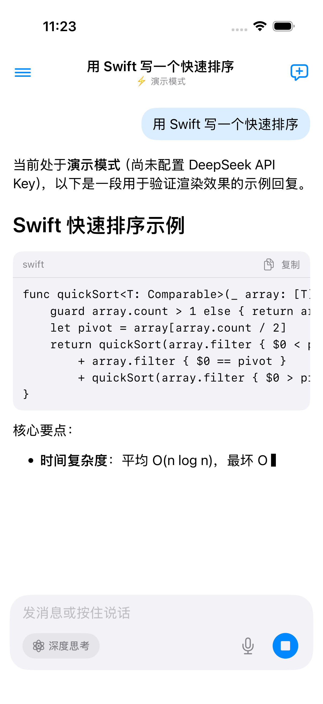
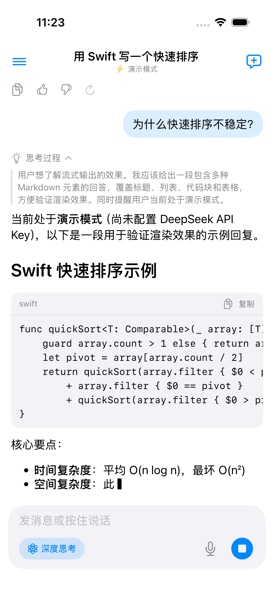
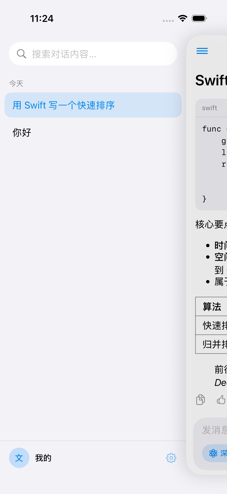

# WBAIProject

AI 方向的 iOS 实践项目集。

## [WBChatApp](WBChatApp/)

接入 DeepSeek 的 AI 聊天 App：SwiftUI + SwiftData + MVVM，自研 URLSession SSE 流式客户端，支持深度思考、重新生成多版本、语音输入、会话管理等完整功能。架构与实现细节见 [WBChatApp/README.md](WBChatApp/README.md)。

| 流式输出 | 深度思考 | 会话抽屉 |
| :---: | :---: | :---: |
|  |  |  |
