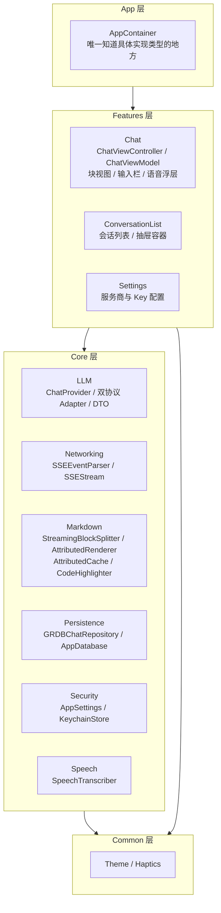

# 00 架构总览

## 一句话定位

用 UIKit + MVVM 实现的仿 iOS 端 ChatGPT 客户端：SSE 流式输出、Markdown 块级增量渲染、流式期间的滚动手势冲突处理、OpenAI/Anthropic 双协议适配、语音转文字，本地 GRDB 持久化多会话历史。

### 功能清单

- 多会话：新建 / 重命名 / 删除 / 左侧抽屉切换，会话列表随数据库变化自动刷新
- 流式对话：SSE 逐字增量显示，支持停止生成、失败重试、对最后一条助手消息重新生成
- Markdown 渲染：标题、段落（含软换行）、有序/无序列表（含嵌套）、引用、表格、分割线、行内代码/粗体/斜体/删除线/链接
- 代码块：语法高亮（Swift / Objective-C / JavaScript / Python / Bash）、横向滚动、一键复制
- 思考过程（reasoning）折叠区：默认折叠，点击展开
- 自动贴底 / 用户手动脱离两态切换，贴合 ChatGPT 的滚动体验
- 语音输入：端上/在线语音识别自动切换，实时波形与文字上屏，识别结果写入输入框而非直接发送
- 服务商设置：DeepSeek / OpenAI / Anthropic 三家可切换，API Key 走 Keychain，可测试连接
- 未配置 Key 时自动进入演示模式（`MockProvider`），保证开箱可用

### 明确不做

- 不做多模态（图片/文件上传、语音消息附件）
- 不做联网搜索、插件、Agent 工具调用
- 不做端到端加密、多端同步
- 不做 iPad 专属布局优化（仅保证基本可用，未做分栏）
- 不做自定义 Markdown 扩展（数学公式、脚注等超出 CommonMark 的语法）
- 不做后台语音唤醒、Siri 集成

## Mermaid 分层图

依赖方向严格单向：`App → Features → Core → Common`。Core 层不依赖 Features，Common 不依赖任何上层。



## 模块职责表

| 目录 | 做什么 | 依赖谁 | 被谁依赖 |
| --- | --- | --- | --- |
| `App/` | 依赖组装：唯一知道 `NetworkChatProvider`/`MockProvider`/`GRDBChatRepository` 等具体类型的地方；负责构造根控制器（抽屉 + 导航） | Features、Core、GRDB、UIKit | 无（顶层） |
| `Features/Chat/` | 聊天页：ViewModel 编排发送/流式/重试，ViewController 装配 tableView、绑定输出、处理滚动与语音 | Core（LLM/Markdown/Persistence/Speech）、Common | App |
| `Features/ConversationList/` | 会话列表 ViewModel/VC，左侧抽屉容器（手势 + 遮罩） | Core（Persistence）、Common | App |
| `Features/Settings/` | 服务商/模型/BaseURL/Key/系统提示词配置，测试连接 | Core（LLM/Security） | App |
| `Core/LLM/` | 统一 `ChatProvider` 抽象；OpenAI 兼容与 Anthropic 两套 `ProviderAdapter` + DTO；演示模式 `MockProvider` | Core/Networking | Features/Chat、Features/Settings |
| `Core/Networking/` | `SSEEventParser`（纯字节解析）、`SSEStream`（HTTP → SSE 事件流） | Foundation | Core/LLM |
| `Core/Markdown/` | 流式切块状态机、单块属性串渲染器、内容寻址缓存、轻量语法高亮 | UIKit（渲染需要 `NSAttributedString`/`UIFont`）、swift-markdown | Features/Chat |
| `Core/Persistence/` | GRDB 建表迁移、`ChatRepository` 协议与实现（含 `ValueObservation` 自动刷新） | GRDB | Features/Chat、Features/ConversationList、App |
| `Core/Security/` | `AppSettings`（UserDefaults + Keychain 门面）、`KeychainStore` | Foundation/Security | Features/Settings、App |
| `Core/Speech/` | `SpeechTranscribing` 协议与 `SFSpeechRecognizer`/`AVAudioEngine` 实现 | Speech、AVFoundation | Features/Chat |
| `Common/` | 全局配色（深浅色自适应 dynamic color）、触感反馈封装 | UIKit | Features、部分 Core（Markdown 渲染取 `Theme.*` 颜色） |

## 完整目录树

与 `find WBChatApp-UIKit/WBChatApp-UIKit -name "*.swift"` 的实际结果一致（不含测试 target）：

```
WBChatApp-UIKit/
├── AppDelegate.swift
├── SceneDelegate.swift
├── App/
│   └── AppContainer.swift
├── Common/
│   ├── Haptics.swift
│   └── Theme.swift
├── Core/
│   ├── LLM/
│   │   ├── AnthropicAdapter.swift
│   │   ├── ChatError.swift
│   │   ├── ChatModels.swift
│   │   ├── ChatProvider.swift
│   │   ├── DTO/
│   │   │   ├── AnthropicDTO.swift
│   │   │   └── OpenAIDTO.swift
│   │   ├── MockProvider.swift
│   │   ├── NetworkChatProvider.swift
│   │   ├── OpenAICompatibleAdapter.swift
│   │   ├── ProviderConfig.swift
│   │   └── StreamChunk.swift
│   ├── Markdown/
│   │   ├── AttributedCache.swift
│   │   ├── AttributedRenderer.swift
│   │   ├── CodeHighlighter.swift
│   │   ├── MarkdownBlock.swift
│   │   ├── MarkdownTheme.swift
│   │   └── StreamingBlockSplitter.swift
│   ├── Networking/
│   │   ├── SSEEvent.swift
│   │   ├── SSEEventParser.swift
│   │   └── SSEStream.swift
│   ├── Persistence/
│   │   ├── AppDatabase.swift
│   │   ├── ChatRepository.swift
│   │   └── Records.swift
│   ├── Security/
│   │   ├── AppSettings.swift
│   │   └── KeychainStore.swift
│   └── Speech/
│       └── SpeechTranscriber.swift
└── Features/
    ├── Chat/
    │   ├── AutoScrollController.swift
    │   ├── ChatViewController.swift
    │   ├── ChatViewModel.swift
    │   ├── StreamThrottle.swift
    │   └── Views/
    │       ├── AssistantMessageCell.swift
    │       ├── BlockStackView.swift
    │       ├── BlockView.swift
    │       ├── BlockViewPool.swift
    │       ├── CodeBlockView.swift
    │       ├── DividerBlockView.swift
    │       ├── InputBarView.swift
    │       ├── MarkdownTextBlockView.swift
    │       ├── ReasoningSectionView.swift
    │       ├── RecordingOverlayView.swift
    │       ├── ScrollToBottomButton.swift
    │       ├── UserMessageCell.swift
    │       └── WaveformView.swift
    ├── ConversationList/
    │   ├── ConversationListViewController.swift
    │   ├── ConversationListViewModel.swift
    │   └── DrawerContainerViewController.swift
    └── Settings/
        ├── SettingsViewController.swift
        └── SettingsViewModel.swift
```

## MVVM 契约

### ViewModel 不 import UIKit

`ChatViewModel`、`ConversationListViewModel`、`SettingsViewModel` 均不 `import UIKit`，只产出纯值类型（`MarkdownBlock`、`BlockPatch`、`ChatError` 等）。属性串渲染（`NSAttributedString`）是视图层的职责，由 `AttributedRenderer`（在 `Core/Markdown`，可以 `import UIKit`）承担。

这条约束由收尾检查脚本核验：

```bash
grep -l "import UIKit" WBChatApp-UIKit/Features/*/[A-Za-z]*ViewModel.swift
```

预期无输出。三个 ViewModel 都用 `@MainActor` 标注（工程默认 `SWIFT_DEFAULT_ACTOR_ISOLATION = nonisolated`，需要显式声明），因为它们直接持有并同步修改 UI 要用的状态，但这与「不 import UIKit」并不矛盾——`@MainActor` 只是并发隔离标注，不引入 UIKit 类型依赖。

### `Output` 拆成 `stateChanged` 与 `blocksPatched` 两条通路

`ChatViewModel.Output` 定义为：

```swift
enum Output {
    case stateChanged(State)
    case blocksReset(messageID: String)
    case blocksPatched(messageID: String, patch: BlockPatch)
    case reasoningUpdated(messageID: String, text: String)
    case streamFinished(messageID: String)
    case failed(ChatError, messageID: String?)
}
```

理由写在源码注释里：**二者混用是流式聊天卡顿的主因**。

- `stateChanged` 表示消息条目的**增删**（新会话第一次进入、发送新消息插入两行）——交给 `UITableViewDiffableDataSource` 走结构化 diff。
- `blocksPatched` 表示同一条消息内部的**流式增量**——不经过 diffable snapshot，直接拿到 `tableView.cellForRow(at:)` 已存在的 cell 实例调用 `applyPatch`，跳过 `dataSource.apply` 的 diff 计算与 cell 重新 configure。

如果把流式增量也走 `stateChanged` → `applySnapshot`，每秒几十次的 delta 都会触发一次 diffable snapshot 的 diff 运算与潜在的 cell 重建，这在长回复上是明显可感知的卡顿来源。拆开之后，`stateChanged` 只在消息数量变化时触发（一次对话大约几次），`blocksPatched` 走的是「拿到已知 cell 实例 + 打补丁」的轻量路径。

## 技术选型理由表

| 选型 | 备选 | 理由 |
| --- | --- | --- |
| TextKit 2（`UITextView` 默认引擎） | `WKWebView` 渲染 HTML | Web 视图有独立的 JS 运行时与 DOM，跨语言桥接（Swift → JS 传增量文本）本身有序列化开销和时序复杂度；原生 `NSAttributedString` 可以直接复用系统排版、无障碍、动态字体等能力，且能与复用池、离屏测量等原生手段配合做增量渲染。见 [02-Markdown块级增量渲染.md](02-Markdown块级增量渲染.md) |
| `UITableView` | `UICollectionView` + 自定义 Layout | 聊天场景是单列纵向列表，`UITableView` 的 `heightForRowAt` + 手动高度缓存已经足够表达；`UICollectionView` 的 compositional layout 对「同一 cell 内部子视图流式增量刷新、不触发 layout 重算」这种场景没有额外收益，反而多一层 layout 抽象要对付 |
| 自算高度（`heightForRowAt` + 手动缓存） | `UITableView.automaticDimension` | `automaticDimension` 依赖 Auto Layout 自底向上求解，每次内容变化都要整条约束链重新求解一遍；流式场景每帧都在变尾块内容，自算高度（`BlockStackView.heightThatFits` 递归调用子视图的 `sizeThatFits`）配合 `AttributedCache` 对已闭合块的高度缓存，才能把这条热路径的代价压到「只测未闭合块」。详见 02 篇「高度策略」一节 |
| GRDB.swift | Core Data / 手写 SQLite | GRDB 提供 `ValueObservation`（数据库变化自动推送，会话列表刷新无需手动轮询）、`FetchableRecord`/`MutablePersistableRecord` 的轻量 Codable 映射、以及可控的迁移器（`DatabaseMigrator`），比 Core Data 的对象图管理更贴合本项目「结构简单、几张表」的需求，也比手写 SQLite 省掉大量样板代码 |
| Swift Concurrency（`AsyncThrowingStream` + `Task`） | Combine / 回调闭包链 | SSE 天然是一个异步序列，`AsyncThrowingStream` 与 `for try await` 能把「网络字节 → SSE 事件 → StreamChunk」这条多级映射写成线性的 `for await` 循环；`Task.cancel()` 顺着 `AsyncThrowingStream` 的 `onTermination` 一路传播到底层 `URLSession.bytes`，取消语义比手动维护 Combine `Cancellable` 集合更直接 |
| CADisplayLink 节流 | `Timer` | 见 [01-流式链路与双协议适配.md](01-流式链路与双协议适配.md) 「节流策略」一节：`CADisplayLink` 天然与屏幕刷新率对齐，保证「每帧最多一次排版」；`Timer` 的触发时机与屏幕刷新不同步，固定间隔（如 1/60s）既可能与 vsync 错拍导致丢帧，也无法在设备为 120Hz 时自动提速 |

## 与同仓库 SwiftUI 版 `WBChatApp` 的对照

同仓库 `/Users/wenbo/Desktop/WBAIProject/WBChatApp` 是同一产品需求的 SwiftUI 实现，可作为技术选型对照：

| 维度 | SwiftUI 版 `WBChatApp` | UIKit 版 `WBChatApp-UIKit`（本项目） |
| --- | --- | --- |
| UI 框架 | SwiftUI（声明式，状态驱动重渲染） | UIKit（命令式，手动管理视图生命周期） |
| 列表 | `List` / `LazyVStack` | `UITableView` + `UITableViewDiffableDataSource` |
| 增量渲染的实现难度 | 依赖 SwiftUI 的 diffing 与 `@State` 自动重绘，天然倾向整体重算 | 需要手写 `BlockStackView.applyPatch` 精确控制「只重建变化的最后一块」，工程量更大但性能路径完全可控 |
| MVVM 边界 | ViewModel 常以 `@Observable`/`ObservableObject` 暴露状态，View 直接订阅属性 | ViewModel 用单一 `Output` 回调 + 拉取式 `state`，View 层显式处理每种 Output case |
| 测试框架 | Swift Testing | Swift Testing（单测）+ XCTest（UI 测试），两仓库对单测框架的选择保持一致 |
| 目录分层 | `Core / App / Features`（三层） | `Common / Core / Features / App`（四层，多一层 `Common` 承载全局主题与触感） |
| 适用场景 | 更快的原型迭代、状态管理心智负担更低 | 更精细的性能控制、更贴近生产级 ChatGPT 客户端的滚动/渲染手感 |

两个项目共享同一份产品设计意图（双协议、流式渲染、语音输入），选型差异集中在「声明式自动 diff」与「命令式手动控制」两种范式在同一问题上的取舍。
