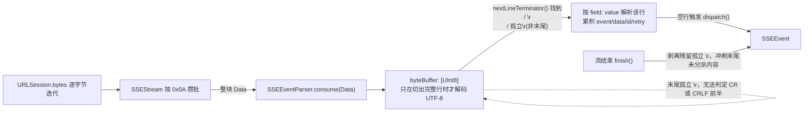
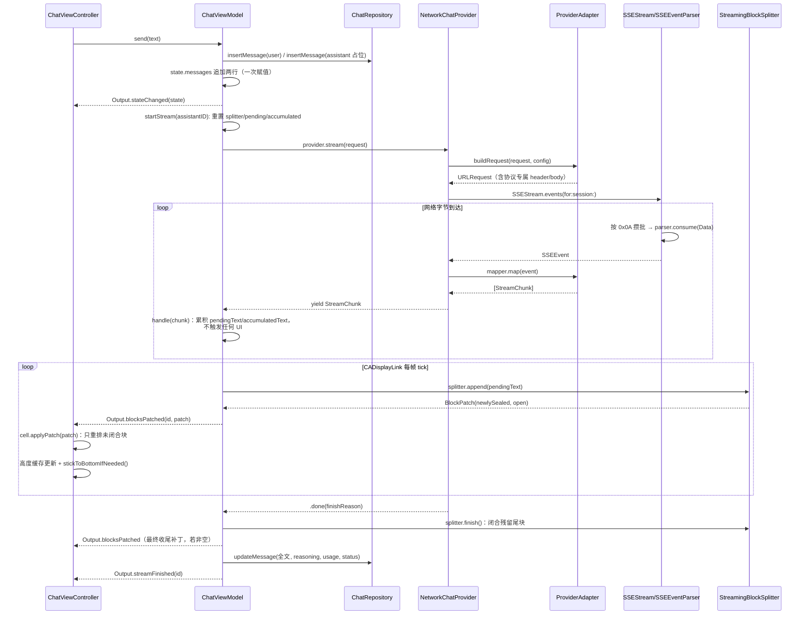

# 01 流式链路与双协议适配

## 1. SSE 规范要点

Server-Sent Events 是纯文本协议，本项目对应的实现是 `Core/Networking/SSEEvent.swift` 与 `SSEEventParser.swift`。规范要点：

- **字段**：每行是 `field: value` 或裸 `field`（无冒号，值视为空串）。已识别字段：`event`（事件类型，未指定时为 `nil`）、`data`（可出现多行，派发时用 `\n` 拼接）、`id`（最后一次事件 ID）、`retry`（重连间隔，毫秒）。未知字段按规范忽略（`SSEEventParser.handle(line:)` 的 `default: break`）。
- **值前导空格**：`field: value` 冒号后若恰好一个空格，规范要求剥离；`SSEEventParser` 用 `value.hasPrefix(" ") { value.removeFirst() }` 实现，且只剥一个。
- **空行派发**：空行是一个事件的结束标记，触发 `dispatch()`。若本次累积的 `dataLines` 为空（例如连续两个空行、或只收到注释行），`dispatch()` 直接返回 `nil`，不产出空事件。
- **注释行**：以 `:` 开头的整行是注释，用于 SSE 连接保活（`: keep-alive` 之类），必须整行丢弃，不作为字段处理。
- **三种换行**：`\n`、`\r\n`、`\r` 都是合法的行终止符，且允许在同一条流里混用。这不是纸面上的边缘情况——`SSEEventParser` 的核心复杂度几乎都来自处理它。

## 2. 三类边界：分包 / 粘包 / UTF-8 劈开

`SSEEventParser` 是一个纯字节缓冲状态机（`private var byteBuffer: [UInt8]`），不做网络 IO，因此可以在单测里逐字节喂入。三类边界：

### 粘包

一次 `URLSession.bytes` 迭代拿到的 `Data` 里可能含多个完整事件。`consume(_:)` 用 `while let terminator = nextLineTerminator()` 循环切出所有已完整的行，一次调用可能产出多个 `SSEEvent`。

### 分包（含跨调用的多字节字符劈开）

一行内容也可能横跨两次甚至更多次 `Data` 回调。解决方式是**按字节而非按字符串缓冲**：`byteBuffer` 存 `[UInt8]`，只有确认切出一整行字节后才 `String(decoding:as: UTF8.self)`。

这个「按字节」的选择不是随意的：如果按字符串增量拼接（每次 `Data` 先各自解码再拼接字符串），UTF-8 多字节字符（中文、emoji）被恰好切在字节中间时，单次解码会产出 U+FFFD 替换字符，且这个错误一旦发生就无法挽回——两次独立解码的结果拼接，永远等不到"劈开的另一半"来纠正。按字节缓冲、整行凑齐后才解码，天然回避了这个问题。

### 换行符跨越回调边界

`\r\n` 本身也可能被切成两截：前一次 `Data` 结尾是 `\r`，下一次 `Data` 开头是 `\n`。`nextLineTerminator()` 对这种情况的处理：

```swift
if byteBuffer[index] == 0x0D {
    // 落在缓冲区末尾的 \r 必须等下一个字节到达，
    // 否则无法区分它是单独的 CR 还是 CRLF 的前半
    if index == byteBuffer.count - 1 { return nil }
    if byteBuffer[index + 1] == 0x0A {
        return LineTerminator(lineEnd: index, consumed: index + 2)
    }
}
```

即：遇到 `\r` 且它恰好是缓冲区最后一个字节时，**不能立即判定**这是一个孤立 CR 还是 CRLF 的前半，必须挂起等下一字节。这个挂起状态在 `finish()`（流正常结束）时必须显式收尾——流已经不会再有下一个字节来解开这个悬念，此时按规范把它当作行终止符处理：

```swift
// finish() 内
if byteBuffer.last == 0x0D {
    byteBuffer.removeLast()
}
```

这一处是 Task 2 审查中发现的真实缺陷：早期实现里 `finish()` 直接把残留字节整段解码，导致孤立的末尾 `\r` 被烙进字段值里（`data` 变成 `"a\r"`），使得 `event` 字段比较失败、`retry` 解析成 `nil`。修复后新增了针对性用例，并做了变异验证（把 `0x0D` 判断改成 `0x0A` 后，只有新增的用例失败，证明测试真的锁住了这个边界）。

### 字节缓冲示意



## 3. 两家协议帧格式对照

| | OpenAI 兼容（OpenAI / DeepSeek） | Anthropic |
| --- | --- | --- |
| 端点 | `POST /v1/chat/completions` | `POST /v1/messages` |
| 鉴权头 | `Authorization: Bearer <key>` | `x-api-key: <key>` + `anthropic-version: 2023-06-01` |
| 开启流式 | body `"stream": true` | body `"stream": true` |
| system 消息 | 并入 `messages` 数组第一条（`OpenAICompatibleAdapter.buildRequest`） | 顶层独立 `system` 字段（`AnthropicAdapter.buildRequest`） |
| 文本增量 | `choices[0].delta.content` | `event: content_block_delta` → `delta.type == "text_delta"` → `delta.text` |
| 思考增量 | `choices[0].delta.reasoning_content` | `event: content_block_delta` → `delta.type == "thinking_delta"` → `delta.thinking` |
| 结束标记 | `data: [DONE]` | `event: message_stop` |
| 用量 | 末帧 `usage` 对象（`prompt_tokens`/`completion_tokens`） | `message_start` 给 `input_tokens`，`message_delta` 给 `output_tokens`，二者拼成 `TokenUsage` |
| 错误 | 非 2xx 状态码 + JSON body（`SSEStream.validate`） | 同上，另有已建立 200 连接内的 `event: error` |

关键差异：**OpenAI 兼容协议只用 `data:` 字段，Anthropic 同时使用 `event:` 与 `data:` 区分帧类型**。这正是为什么 `SSEEventParser` 必须是完整的 SSE 实现而不能只做 `data:` 前缀截取——`AnthropicChunkMapper.map(_:)` 是靠 `switch event.event` 分派 `message_start` / `content_block_delta` / `message_delta` / `message_stop` / `error` 五种帧的。

### 真实报文样例

OpenAI 兼容协议的一帧文本增量：

```
data: {"choices":[{"delta":{"content":"你好"},"finish_reason":null}]}

```

结束帧：

```
data: [DONE]

```

Anthropic 的一帧文本增量（注意 `event:` 与 `data:` 成对出现）：

```
event: content_block_delta
data: {"delta":{"type":"text_delta","text":"你好"}}

```

Anthropic 的思考增量：

```
event: content_block_delta
data: {"delta":{"type":"thinking_delta","thinking":"让我想想"}}

```

Anthropic 的流结束：

```
event: message_stop
data: {}

```

两种协议的 mapper 都用 `guard let payload = try? decoder.decode(...) else { throw ChatError.decoding(...) }` 处理"JSON 语法本身损坏"，但对"JSON 合法、可选字段缺失"（如 `usage` 未出现）一律走默认值而不抛错——这条区分在 Task 5 的审查中被专门验证过：`{}`、`{"message":{}}`、`{"message":{"usage":{}}}` 三种"字段缺失但语法合法"的输入都不应误判为错误，只有真正语法损坏的输入才抛。

## 4. Mermaid 时序图：从 send 到落库



## 5. 节流策略

网络 delta 到达频率可达每秒数十到上百次，若每个 delta 都直接触发切块 + 排版 + 贴底，会产生大量重复且无意义的工作。`ChatViewModel` 把网络回调与 UI 更新解耦成两个独立频率：

- `for try await chunk in provider.stream(request)` 内只做累积（`handle(_:)`：`pendingText += text`），**不触发任何 UI**。
- `StreamThrottling`（生产实现 `DisplayLinkThrottle`，`Core` 为 `Features/Chat/StreamThrottle.swift`）持有 `CADisplayLink`，每帧回调一次 `onTick`，`ChatViewModel.flush()` 把攒下的 `pendingText` 一次性喂给 `splitter.append(_:)`，产出的 `BlockPatch` 才真正推给视图层。

### 为什么用 `CADisplayLink` 而非 `Timer`

`CADisplayLink` 与屏幕的 vsync 信号直接绑定，触发时机永远是"下一次即将合成的那一帧之前"；`Timer` 是基于 RunLoop 的定时器，即使设成 1/60 秒间隔，实际触发时机也会因 RunLoop 调度、主线程忙碌程度而漂移，与真实的屏幕刷新节奏不同步——既可能在同一帧内触发两次做无用功，也可能错过某一帧的合成窗口导致视觉上的丢帧。此外，`CADisplayLink` 在 120Hz ProMotion 设备上会自动按 120Hz 触发，`Timer` 若写死间隔则不会随设备刷新率自适应。

### 「每帧最多一次排版、最多一次贴底」的含义

因为 UI 更新的驱动源从「网络到达速率」换成了「屏幕刷新速率」，无论网络在一帧的时间窗口内产生多少个 chunk，`flush()` 每帧只会被调用一次，因此：

- 切块器 `splitter.append(_:)` 每帧最多调用一次——本帧攒下的所有增量文本被合并成一次调用，而不是逐 chunk 调用。
- `applyPatch` 触发的 `tableView.beginUpdates()/endUpdates()`（用于让 `heightForRowAt` 重新求值）每帧最多触发一次。
- `stickToBottomIfNeeded()`（贴底滚动）每帧最多调用一次——避免同一帧内多次设置 `contentOffset` 造成的抖动。

## 6. 取消与错误

### `Task.cancel()` 如何一路传到 `URLSession`

取消链路跨越三层 `AsyncThrowingStream`：

```
ChatViewModel.stop()
  → streamTask?.cancel()                         (ChatViewModel 持有的顶层 Task)
    → NetworkChatProvider.stream 内的 Task 感知取消
      → for try await event in SSEStream.events(...) 抛出 CancellationError
        → SSEStream 内层 continuation.onTermination 触发
          → 内层 task.cancel()（负责 session.bytes 迭代的 Task）
            → URLSession.bytes(for:) 的字节迭代抛错，底层连接被释放
```

两级 `AsyncThrowingStream` 都在各自的 `continuation.onTermination = { _ in task.cancel() }` 里把取消转发给内部持有的 `Task`。`NetworkChatProvider.stream` 的主循环里还有一处显式检查点：

```swift
for try await event in SSEStream.events(for: urlRequest, session: session) {
    try Task.checkCancellation()
    for chunk in try mapper.map(event) { continuation.yield(chunk) }
}
```

`ChatViewModel` 侧的循环也有类似检查点，但顺序经过了刻意调整（见下）。

### 失败时如何保留已生成内容

`ChatViewModel.startStream` 的消费循环：

```swift
for try await chunk in provider.stream(request) {
    guard let self else { return }
    self.handle(chunk)          // 先处理已到手的增量
    try Task.checkCancellation() // 再检查是否该停止
}
```

这个顺序是刻意的，且与简报参考实现的顺序相反（简报原版是先 `checkCancellation()` 再 `handle(chunk)`）。原因：`stop()` 与"已经从网络到达但还没被处理"的这个 chunk 之间存在竞态。如果先检查取消，`stop()` 恰好在这个时间点被调用，最后一个已经到手的增量会被直接丢弃而不进入 `accumulatedText`，违背了"停止生成时应保留已生成内容"的产品语义。调整为先处理、再检查，保证任何已经从网络收到的字节都不会被取消检查吞掉——取消被感知的时延不变，只是"最后一个 chunk 是否被处理"的结果不同。

`finishStream(error:)` 无论正常结束、取消还是失败都会执行同一套收尾：

```swift
flush()                              // 把最后攒下的 pendingText 喂一次
let finalPatch = splitter.finish()   // 闭合残留的未闭合块
...
updateMessage(id: messageID, text: accumulatedText, ...)  // 落库
```

`.cancelled` 错误映射到 `MessageStatus.stopped`（不是 `.failed`），气泡保留已生成的全部文本并显示"已停止"，而非清空。`ChatError.from(_:)` 把 `CancellationError` 与 `URLError.cancelled` 都归一到 `.cancelled`，两条取消来源（本地 `Task.cancel()` 与系统网络层取消）在上层看到的是同一种错误。
