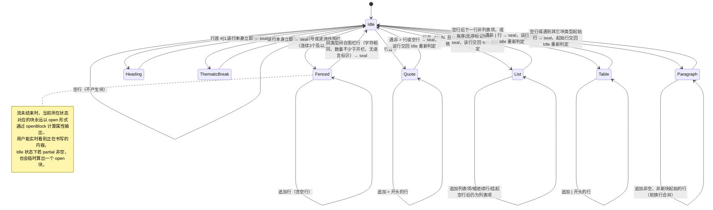
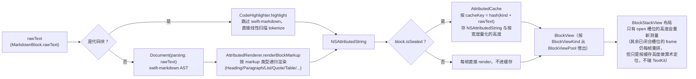

# 02 Markdown 块级增量渲染

这是整个项目里技术含量最高的部分：如何在 SSE 逐字符到达的场景下，让 Markdown 渲染的总代价从 O(n²) 降到 O(n)，同时不破坏视觉稳定性（已经渲染出来的内容不能跳动、不能重排）。

## 1. 问题陈述与复杂度分析

### 朴素做法

最直接的实现：每收到一个 delta，就把**累积到目前为止的整条消息**重新交给 Markdown 解析器，重新生成一份 `NSAttributedString`，重新计算高度，重新触发布局。

设一条消息最终长度为 `n` 个字符，SSE 以字符级/小 chunk 级增量到达，增量次数与 `n` 同阶。第 `k` 次增量到达时，需要重新解析的文本长度是 `O(k)`（累积到当前的全部内容），重新解析 + 重新排版的代价与文本长度成正比，也是 `O(k)`。

总代价：

```
T(n) = Σ(k=1 to n) O(k) = O(1 + 2 + 3 + ... + n) = O(n(n+1)/2) = O(n²)
```

这是标准的"每次都从头重算"级数求和，与"每次插入都重新排一次序"是同一类复杂度陷阱。对短回复（几十字）感知不到，但 ChatGPT 式应用常见的几百到几千字的长回复，`n²` 的增长会在真机上表现为肉眼可见的掉帧——且越往后越卡，因为每一帧要重新解析的文本量随时间线性增长。

### 本项目的做法：分块 + 缓存已闭合块

核心手段是把消息切成 Markdown **块**（`MarkdownBlock`），每个块只有两种状态：

- **sealed（已闭合）**：后续文本不可能再改变它的 `rawText`。
- **open（未闭合）**：仍在被写入，其内容随流推进而变化。

任意时刻，一条消息的块序列有且只有一个 open 块（如果流还没结束的话），其余全部 sealed。每帧只需要：

1. 把 sealed 块的渲染结果（`NSAttributedString` 与高度）**从缓存里直接取用**，不重新解析——这部分工作在块闭合的那一刻已经做过一次；只要渲染宽度不变，此后不再重做（`BlockStackView` 按槽位标脏：只有新固化或仍在追加的那个槽位会被标记为待重算，其余已闭合槽位原样复用上一帧的结果；宽度变化时才整体失效、全部重算）。
2. 重新解析并测量**唯一的那个 open 块**——它每帧都会被重新测量，不进任何缓存。

设块的平均长度为常数 `b`（由 Markdown 语法结构决定：一个段落、一个列表项、一个代码块……长度不会随消息总长 `n` 无限增长，`b` 与 `n` 无关），则：

- 每个块从 open 变为 sealed 时被完整渲染一次：全消息约有 `n/b` 个块，这部分总代价是 `O(n/b × b) = O(n)`。
- 每一帧只重新渲染当前唯一的 open 块，代价是 `O(b)`（常数）；帧数由 `CADisplayLink` 的刷新节奏决定，不随消息长度线性增长（长回复不会让每帧变慢，只会让帧数变多，但每帧代价不变）。

把"随帧数增长的常数代价"与"随块数增长的线性代价"相加，总代价是 `O(n)`——不是 `O(n × 帧数)`，因为 open 块本身的长度有上界，不会随 `n` 无限增长。这就是"块级增量"相对于"全量重解析"的复杂度优势来源。

## 2. 核心不变量

> **sealed 块序列随流式推进只增不改**：已经 seal 的块，其 `rawText` 永不变更、永不回退、集合永不删除元素。

这条不变量是整个缓存体系成立的前提——如果 sealed 块可能被悄悄改动，`AttributedCache` 里缓存的 `NSAttributedString` 就可能与实际内容不一致，渲染出错误但不报错的画面。

### 这是结构性保证，不是运行时巧合

`StreamingBlockSplitter.sealedBlocks` 的声明是：

```swift
private(set) var sealedBlocks: [MarkdownBlock] = []
```

全项目搜索，`sealedBlocks` 只在一处被写入：

```swift
private mutating func seal() -> MarkdownBlock {
    ...
    sealedBlocks.append(sealed)
    ...
}
```

没有任何下标赋值（`sealedBlocks[i] = ...`），没有任何删除（`removeAll`/`remove(at:)`）。这意味着"sealed 块只增不改"不是靠状态机的分支逻辑"恰好"没有走到某条会破坏它的路径而成立的，而是**类型系统层面就不存在破坏它的代码路径**——唯一能触碰这个数组的入口只有 `append`。这条保证不会因为未来给状态机加新分支、加新的块类型而意外失效，除非有人故意在新代码里绕过 `seal()` 直接操作 `sealedBlocks`。

### 为什么段落必须多行合并、不能"单行即封"

`.paragraph` 分支是状态机里唯一允许跨越多个非空行持续累积的分支：

```swift
case .paragraph:
    if isBlank {
        sealed.append(seal())
    } else if Self.startsNewBlock(currentLine) {
        sealed.append(seal())
        lineToProcess = currentLine
    } else {
        block.lines.append(currentLine)   // 追加，不闭合
        current = block
    }
```

实现过程中出现过一版"看到完整行就立即 seal"的实现（把段落当成单行块处理），理由是这样代码更简单。这个方向被判定为错误，两条理由：

1. **语义正确性**：Markdown 里连续的非空行属于同一段落（软换行，渲染时应合并展示，中间只是一个空格或换行，而非独立段落）。单行即封会把一个自然段拆成多个独立块，UI 层会在它们之间插入 `blockSpacing`，渲染成多个带间距的"假分段"，与源内容的语义不符。
2. **决定性理由：测试判别力**。项目里有一条 `crlfSplitAcrossAppends` 用例，专门验证"`\r\n` 被恰好切在两次 `append` 调用之间时仍能被正确识别为一个换行"。如果段落采用"单行即封"，这条测试在"正确处理 CRLF"与"把 `\r` 误判为独立行结束符"两种情况下都会得出**同样的**分块结果，因为每一行反正都会立刻单独封存——测试对它原本要抓的那个 bug 完全失去了区分力。这正是当时复现的反常现象：按简报建议对 `nextLineTerminator()` 做变异（比如让 CR 判断出错），结果没有任何用例失败。改成"多行累积、遇空行才封"之后，同样的变异会精确命中 `crlfSplitAcrossAppends`（期望值从 `["a", "b"]` 改为 `["a\nb"]`），其余用例不受影响——测试的判别力被找回来了。

这个案例是"测试用例的期望值本身可能悄悄掩盖设计缺陷"的一个具体样本：不是代码写错了，而是最初的测试期望值恰好让一个真实存在的语义错误看起来"测试全绿"。

### 不变量如何被测试守住

`StreamingBlockSplitterTests` 用逐字符/逐片段喂入的方式驱动状态机，包括刻意把内容切在各种边界上（CRLF 跨调用、代码围栏跨调用、列表标记切换、末尾孤立 CR 等），每次都断言：已经出现在 `sealedBlocks` 里的块在后续调用中原样保留（不检查它是否被改写，而是直接比较整个数组前缀）。这类测试配合"变异验证"方法论——先让测试通过，再故意在实现里引入一个已知缺陷（比如把 CR 判断条件改错、把列表续行判断顺序打乱），确认恰好是新增的针对性用例失败、其余用例不受影响，从而确认测试真的在保护对应的行为，而不是"凑巧全绿"。

## 3. Mermaid 状态图：切块状态机



### 尾块永远 open

`StreamingBlockSplitter.openBlock` 是一个计算属性，不是存储状态：只要流没有调用 `finish()`，当前正在累积的块（无论处于状态图里的哪个状态）都会连同还没等到换行符的 `partial` 尾部文本一起，实时组装成一个 `isSealed: false` 的 `MarkdownBlock` 返回。这保证了两件事：

1. 用户能看到"正在打字"的实时内容，不需要等到块闭合才显示。
2. 已闭合块与这个 open 块之间有严格边界——`openBlock` 的计算不会触碰 `sealedBlocks`，`append(_:)` 返回的 `BlockPatch.open` 与 `newlySealed` 是两个独立通道，上层（`BlockStackView.applyPatch`）据此区分"哪些视图可以被就地更新"（open 块对应的最后一个视图）与"哪些视图建好后就不再触碰"（newlySealed 对应的视图）。

`heading` 与 `thematicBreak` 两类是唯一在开块的同一行就立即 seal 的类型（`MarkdownBlockKind.sealsOnSingleLine`）——它们本身就是单行语法，没有"多行累积"的必要，识别到即完整。

## 4. 渲染管线图



`AttributedRenderer` 刻意只处理**单个块**：swift-markdown 每次解析的输入只有几十到几百字（一个块的长度），而不是整条消息，这是复杂度分析里"块渲染代价与 `n` 无关"的直接体现。代码块完全绕开 swift-markdown——`CodeHighlighter` 做的是自己的线性扫描 tokenize（识别注释/字符串/数字/关键字），既省一次 AST 解析，也便于处理未闭合的代码块（没有结尾围栏时 swift-markdown 的 `CodeBlock` 节点可能无法正确识别，而 `AttributedRenderer.codeText(of:)` 是按行手动剥围栏，天然兼容"还没写完"的输入）。

## 5. TextKit 2 章节

### 为什么选它

`MarkdownTextBlockView` 内部用的是非编辑态 `UITextView`，iOS 16+ 上默认由 TextKit 2（`NSTextLayoutManager`/`NSTextContentStorage`）驱动，而非传统的 TextKit 1（`NSLayoutManager`/`NSTextStorage`）。TextKit 2 的设计目标之一就是支持增量式的文本内容变更与按需布局，这与本项目"只有尾块内容在变、已有内容不该被重新触碰"的场景在架构理念上是一致的方向。选择让系统按默认路径走 TextKit 2，而不是主动 opt-out 到 TextKit 1，是希望尽可能借助系统原生的增量能力，而不是在应用层重新发明一套文本布局引擎。

### `layoutManager` 静默降级陷阱

TextKit 2 有一个不直观但需要严格遵守的规则：**只要访问一次 `UITextView.layoutManager` 或 `UITextView.textStorage`，UIKit 就会把该 `UITextView` 静默切回 TextKit 1 兼容模式**，且这个切换没有任何警告或错误，代码依然能编译运行，只是从此丧失 TextKit 2 的增量布局能力——是那种"改了没报错、跑起来也看不出差异，但性能特性已经完全变了"的陷阱。

项目对此的应对是显式的类级别红线注释：

```swift
/// ⚠️ 全类禁止访问 `textView.layoutManager` 与 `textView.textStorage`——
/// 只要碰一次，UIKit 就会静默回退到 TextKit 1，增量排版的收益全部作废。
/// 需要底层能力时一律走 `textLayoutManager` / `textContentStorage`。
final class MarkdownTextBlockView: UIView, BlockView {
```

以及全项目级别的 grep 红线自查（收尾检查脚本的一部分）：

```bash
grep -rn "layoutManager\|\.textStorage" WBChatApp-UIKit --include=*.swift
```

预期只命中一行——`MarkdownTextBlockView.swift` 里那条禁令注释本身（注释文字里直接写了 `layoutManager`/`.textStorage` 这两个词，被自己定的红线正则命中），除此之外不应再有其它输出。这不是正则误报：这个正则是大小写敏感的子串匹配，`textLayoutManager` 里紧跟在 `text` 后面的是大写的 `LayoutManager`，与小写开头的模式串 `layoutManager` 逐字符比较不相等，不会误报命中；`textContentStorage` 同理不会命中 `\.textStorage`（后者还额外要求前面有一个字面量 `.`）。也就是说，实测的这一行命中是真实的子串匹配，只是命中对象是注释文字而非代码里的属性访问，全项目不存在任何真实的 `layoutManager`/`textStorage` 属性访问。

### 哨兵测试

`MarkdownTextBlockView` 暴露了一个只读断言点：

```swift
/// 供测试断言：确认没有意外退回 TextKit 1
var usesTextKit2: Bool { textView.textLayoutManager != nil }
```

`BlockViewTests.swift` 与 `SmokeTests.swift` 都对它做了断言（`#expect(view.usesTextKit2)` / `#expect(textView.textLayoutManager != nil)`）。这类哨兵测试的价值在于：它不测试任何具体渲染结果，只测试"系统内部走的是哪条路径"，能在 CI 里及时抓住"未来某次改动不小心引入了 `layoutManager` 访问"这种不会导致功能性失败、但会悄悄拖垮性能特性的回归。

## 6. 高度策略

### 为什么放弃 `automaticDimension`

`UITableView.automaticDimension` 依赖 Auto Layout 自底向上求解约束链：cell 内部每个子视图先各自求出 intrinsic size，再逐层向上传播、求解整条约束链，得到最终行高。这套机制的前提假设是"内容变化不频繁，偶尔求解一次可以接受"。

流式场景恰恰相反：open 块的内容**每一帧都在变**（哪怕只是追加了几个字符），如果用 `automaticDimension`，每一帧都要让 Auto Layout 引擎重新求解整条约束链——包括所有没有变化的 sealed 块。这与本文第 1 节的复杂度分析目标直接冲突：好不容易把"内容重解析"的代价压到了只有 open 块，如果高度求解仍然是"全量重算"，性能收益就在这一步被吃掉了。

项目改为在 `ChatViewController` 里实现 `UITableViewDelegate.tableView(_:heightForRowAt:)`，自己维护一份按 `messageID` 索引的高度缓存（`heightCache: [String: CGFloat]`），高度来自 `BlockStackView.heightThatFits(width:)`——递归调用每个子块视图的 `heightThatFits(width:)`（`UITextView.sizeThatFits(_:)`，不经过 Auto Layout 约束求解），再求和加上块间距。

这条路径上实际叠着两层缓存，失效粒度各不相同：

1. **`BlockStackView` 自己的槽位缓存**（`cachedHeights: [CGFloat?]`，`ensureHeights` 维护）：与 `blockViews` 一一对应，`nil` 表示待重算。`appendView` 只给新追加的槽位置 `nil`；`updateView`（就地固化上一帧的未闭合块，或未闭合块继续追加文字）只把**它自己那一个槽位**置 `nil`；其余已闭合槽位的缓存值原样保留，不会被批量清空。只有渲染宽度变化（`cachedWidth != width`）时才整体重建整个数组，强制全部槽位重新测量——不同宽度下的高度本就需要重新算，这不是失效，是必要的重算。
2. **`AttributedCache.height(for:width:render:measure:)`**（按 `cacheKey` + 量化后的宽度作为键的全局缓存，与某个 `BlockStackView` 实例无关，`NSCache` 支撑，能跨 cell 复用命中）：`ensureHeights` 对槽位缓存里为 `nil` 的项调用 `computeHeight`——已闭合块（`block.isSealed`）才会走到这层缓存；唯一的未闭合块永远绕开它，直接调 `view.heightThatFits(width: width)` 每帧重测，不写入任何缓存（它的内容每帧都在变，缓存了也马上作废）。

两层叠加的效果：一个已闭合块的高度，在同一宽度下只会被真正测量一次（此后无论是命中第 1 层的槽位缓存，还是退化到命中第 2 层的全局缓存，都不会再重新排版）；宽度变化或该块被撤回（流中止）时才会让对应槽位重新计算。

### 真正测量那一次用的是什么

缓存未命中时，`computeHeight` 不再去测活视图，而是交给 `TextKitMeasurer`——一套**没有视图**的 TextKit 2 栈（`NSTextContentStorage` + `NSTextLayoutManager` + `NSTextContainer`），量完读 `usageBoundsForTextContainer`。块级测高因此变成纯值计算，不再要求「先有一个配置好的 `UITextView`」。

这里最初按 CoreText（`CTFramesetterSuggestFrameSizeWithConstraints`）实现过一版，实测与视图相差 0~3pt，而且误差随字号与行数变化、不是一个能补偿掉的固定偏移——TextKit 对每个 line fragment 的取整规则 CoreText 复现不出来。块视图内部的 `UITextView` 本来就由 TextKit 2 驱动，**用同一个引擎量，一致性是结构性的而不是靠调参凑出来的**。`TextKitMeasurerParityTests` 用 16 组语料 × 5 种宽度把这条锁住，`TextKitMeasurer.canMeasure(_:)` 是允许名单的唯一事实来源，名单外的类型（分割线）回退到视图测量。

两个前提写在测量器的注释里：块视图的 `textContainerInset = .zero` 与 `lineFragmentPadding = 0`。这两项配置一旦被改掉而测量器没跟着改，高度就会悄悄算错，所以 Debug 下还留了一道影子校验——两条路都算一遍，对不上直接断言失败。

未闭合块仍然走视图测量：它的属性串这一帧刚在 `configure` 里设进视图，为了测高再渲染一份纯属浪费，而未闭合块必然有活视图在手。

### `beginUpdates`/`endUpdates` 的代价分析

高度变化后要让 `UITableView` 感知到（否则视图的 frame 和 tableView 认为的行高会脱节），项目用的是裸的：

```swift
UIView.performWithoutAnimation {
    tableView.beginUpdates()
    tableView.endUpdates()
}
```

这一对调用中间**不夹带任何** `insertRows`/`deleteRows`/`reloadRows` 之类的结构性 mutation，唯一效果是强制 `UITableView` 重新查询一遍可见行的 `heightForRowAt`（进而读到 `heightCache` 里已经更新过的新值），代价是一次可见区域内的布局传递，而不是整个 `NSAttributedString` 重新排版——高度计算本身在调用 `beginUpdates`/`endUpdates` 之前就已经通过 `heightThatFits` 算完并存进 `heightCache`，这一步只是"通知 UITableView 来读新值"。

这里有一个容易踩的坑：`ChatViewController` 的 `dataSource` 是 `UITableViewDiffableDataSource`。iOS 15+ 起，若直接调用 `tableView.reloadRows(at:with:)`/`insertRows`/`deleteRows` 这类结构性 mutation API，会触发 `NSInternalInconsistencyException`（"必须通过 diffable data source 的 API 更新"）。Task 16 实现时按简报参考实现直接调了 `reloadRows`，在模拟器上实测**每发一条消息、流结束时必现崩溃**——这个缺陷单靠读 diff 发现不了，必须真的跑起来。修复方式是流结束/失败这两个"仅有的"结构性刷新点改用 `snapshot.reconfigureItems([messageID])` 走 diffable data source 自己的更新通道；而流式期间高频调用的 `beginUpdates`/`endUpdates`（用于强制重新查询行高）因为中间没有夹带任何结构性 mutation，不受 diffable data source 的守卫拦截，属于社区通行的"仅强制刷新可见行几何信息"的手法，予以保留。两者用途不同：`reconfigureItems` 用在低频的"这一行需要被完全重新 configure"场景，`beginUpdates`/`endUpdates` 用在高频的"内容没变身份、只是几何尺寸变了，需要 tableView 重新读一遍高度"场景。

## 7. 复用池

### 为什么 `UITextView` 需要按类型回收

`BlockViewPool` 按 `BlockViewKind`（`text`/`code`/`divider`）分类维护空闲队列。原因：

1. **创建代价**：`UITextView` 内部要初始化 TextKit 2 的排版栈（`NSTextLayoutManager`/`NSTextContentStorage` 等），不是一个轻量对象。一条长回复可能切出十几个块，`cell` 本身又会被 `UITableView` 反复复用（滚动、离屏、复用），如果每次都新建 `MarkdownTextBlockView`/`CodeBlockView`，滚动性能会明显劣化。
2. **配置不通用**：`MarkdownTextBlockView` 与 `CodeBlockView` 内部都是 `UITextView`，但配置完全不同——前者 `isScrollEnabled = false` 靠外层高度撑开，后者 `textContainer.widthTracksTextView = false` 且设了固定超大 `textContainer.size` 以支持横向滚动不换行。把二者混在一个队列里回收会导致"借出来的视图配置对不上要渲染的块类型"，因此 `BlockViewPool` 必须按类型分桶。

`BlockView` 协议要求实现类声明 `static var viewKind: BlockViewKind`，`BlockViewPool.recycle(_:)` 直接读取 `type(of: view).viewKind` 做归类。这是 Task 13 审查发现的一处改进：早期实现里"新建视图用什么 kind"（`BlockViewKind.kind(for:)`，按 `MarkdownBlockKind` 映射）与"回收视图归哪个队列"是两套独立的映射逻辑，没有单一事实来源；新增视图类型时若忘了同步更新回收侧的 `switch`，会悄悄落进 `default` 分支、类型错配却不报错。改为让视图自己声明 `viewKind` 后，新增一种 `BlockView` 实现类型，编译器会强制要求声明它，不存在"忘了同步"的可能。

### 离屏测量与共享池的相互作用

`ChatViewController` 为 `heightForRowAt` 的离屏测量准备了两个**常驻**的测量专用 cell（`measuringAssistantCell`/`measuringUserCell`），而不是每次测量都 `AssistantMessageCell(...)` 新建一个。原因：`AssistantMessageCell` 内部的 `BlockStackView` 持有的是全局共享的 `BlockViewPool`（同一个池子也服务于屏幕上真实显示的 cell）。如果每次测量都新建一个临时 cell，它内部的 `BlockStackView` 会从共享池借走块视图，测量完这个临时 cell 被丢弃、ARC 释放，但它借走的视图从未被 `recycle(_:)` 归还——池子被逐渐"掏空"，最终真实滚动时的 cell 复用退化成"只能不断新建"，恰好是引入复用池想要规避的开销。

修复方式是让常驻测量 cell 在每次 `configure` 之前先调用 `prepareForReuse()`，把上一次测量借走的块视图先还给池子，再借新的，做到收支平衡。项目里专门有 `BlockViewPoolBalanceTests` 用 `idleCountForTesting(_:)`（只读访问器）验证这一点。

**这套机制现在只剩一半必要。** 块级测高已经交给 `TextKitMeasurer`，不再需要活视图；但 `AssistantMessageCell.heightThatFits` 还要量 `reasoningView`、`errorLabel`、「重新生成」按钮，`UserMessageCell` 的气泡也一样，所以 cell 级测高仍然依赖常驻测量 cell。等这几处也改成无视图测量，常驻测量 cell 与这里的收支平衡逻辑就可以一并删掉——这是下一步，不在本轮范围内。

## 8. 实测数据

> **待实测**：本节的性能数字需在真机上用 Instruments 采集后填入，以下只给出测量方法与对照设计，不包含任何编造的数值。

### 复现步骤

1. 在设置里不配置任何 API Key，触发 `AppContainer.makeProvider()` 走 `MockProvider` 演示模式；将 `MockProvider.defaultScript` 临时替换/追加为一段约 3000 字、覆盖标题/段落/列表/代码块/表格的 Markdown 文本（可复用现有 `defaultScript` 的结构按比例扩写）。
2. 用 Xcode → Product → Profile 启动 Instruments，选择 **Time Profiler** + **Core Animation**（或 SwiftUI/UIKit 对应的 Hitches 度量）两个模板，附加到真机（模拟器的 CPU/帧率数据不具代表性）。
3. 在 App 里发送一条会触发上述长回复的消息，从用户点击发送开始记录，到流式输出完全结束（`streamFinished`）为止。
4. 采集指标：
   - **帧率/掉帧（Hitches）**：Core Animation 模板的 FPS 曲线，或 Hitches 模板给出的"卡顿次数与卡顿总时长"。
   - **CPU 占用**：Time Profiler 里主线程在 `flush()`/`applyPatch`/`heightThatFits`/`AttributedRenderer.render` 等符号上的耗时占比。
   - **内存**：Allocations 模板观察 `AttributedCache` 与 `BlockViewPool` 在长回复期间的对象增长曲线，确认符合"已闭合块只渲染一次、复用池不会无限增长"的预期。

### 对照组设计

为了证明块级增量渲染确有收益，需要一个"每帧全量重解析"的对照实现：可以在 `ChatViewModel.flush()` 里临时改造出一个开关，让它不调用 `splitter.append(_:)` 的增量接口，而是每帧都对 `accumulatedText` 全量跑一遍 `StreamingBlockSplitter`（从头 `append` 全部累积文本 + `finish()`），并让 `AttributedRenderer` 对每个块都强制跳过 `AttributedCache`（即便 `isSealed == true` 也每次重新 `render`）。用同一段 3000 字脚本、同一台设备分别跑增量版与对照版，对比两组 Time Profiler / Hitches 数据。

预期的定性结论（复杂度分析已经证明，需要用上述步骤采集实测数字验证）：对照组随着回复变长，每帧耗时应表现出随时间递增的趋势（因为每帧重解析的文本量线性增长）；增量版每帧耗时应大致平稳（因为每帧只处理长度有界的 open 块）。具体的帧率、CPU 占用百分比、耗时毫秒数需要按上述步骤在真机采集后填入本节。
