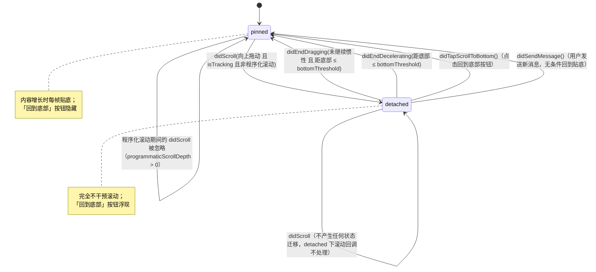

# 03 滚动与自动贴底

流式输出期间，内容在不断变高，滚动位置该不该跟着走，是聊天类 App 里最容易做得"别扭"的交互细节之一。本项目用一个不持有 `UIScrollView`、纯计算的状态机（`AutoScrollController`）仲裁这个问题，对标 ChatGPT 客户端的实际行为。

## 1. Mermaid 状态图：`pinned ⇄ detached`



状态之间不存在第三态：只有 `pinned` 与 `detached` 两种，任何一次 `UIScrollViewDelegate` 回调转发进来，都只会触发上表列出的迁移之一或保持不变，没有隐藏分支。

## 2. 与 ChatGPT 行为逐条对照

| 行为 | ChatGPT 表现 | 本实现 | 对应代码位置 |
| --- | --- | --- | --- |
| 内容流式增长时的默认状态 | 自动跟随内容贴底 | 默认 `mode = .pinned`，每次 `applyPatch`/`applyReasoning` 之后调用 `stickToBottomIfNeeded()`，若 `shouldStickToBottom` 为真则无动画设置 `contentOffset` | `AutoScrollController.mode` 初值；`ChatViewController.applyPatch(messageID:patch:)` / `applyReasoning(messageID:text:)` 末尾的 `stickToBottomIfNeeded()` |
| 用户向上滑动查看历史内容 | 立即脱离自动贴底，之后内容再怎么增长都不会打断用户正在看的位置 | `didScroll(offsetY:isTracking:)` 检测到"手指在追踪 + 偏移量比拖动起点更小（向上拖）"时，把 `mode` 置为 `.detached` | `AutoScrollController.didScroll(offsetY:isTracking:)` |
| 向下拖动（继续追内容） | 不会被误判为"脱离" | `didScroll` 里 `guard offsetY < dragStartOffsetY else { return }`——只有向上拖（offset 变小）才脱离，向下拖不改变状态 | 同上 |
| 脱离贴底后内容继续增长 | 用户当前看到的内容视觉位置不动，不会被打断，但也看不到新内容自动出现在眼前 | `detached` 状态下所有滚动相关回调都不主动挪动 `contentOffset`——`stickToBottomIfNeeded()` 的 `guard autoScroll.shouldStickToBottom` 直接短路 | `AutoScrollController.shouldStickToBottom`；`ChatViewController.stickToBottomIfNeeded()` |
| 脱离贴底后出现「回到底部」悬浮按钮 | 有 | `onModeChange` 回调驱动 `scrollToBottomButton.setVisible(mode == .detached)` | `ChatViewController.bindAutoScroll()` |
| 用户手动滑回底部附近 | 自动重新贴底，之后继续流式跟随 | 拖动结束（`didEndDragging`/`didEndDecelerating`）时若距底部 `≤ bottomThreshold`（40pt），重新置为 `.pinned` | `AutoScrollController.repinIfNearBottom(_:)` |
| 点击「回到底部」按钮 | 平滑滚动到底部，并恢复自动贴底 | `handleScrollToBottom()` 用动画滚动到底部，同时无条件 `didTapScrollToBottom()` 置为 `.pinned` | `ChatViewController.handleScrollToBottom()` |
| 用户发送新消息 | 无条件滚动到底部（哪怕之前正在往上翻看历史） | `didSendMessage()` 无条件把 `mode` 置为 `.pinned`，在 `inputBar.onSend` 与「重新生成」入口都会调用 | `AutoScrollController.didSendMessage()`；`ChatViewController.setUpViews()` 里的 `inputBar.onSend`、`handleRetryTapped`、长按菜单里的「重新生成」 |
| 「回到底部」动画滚动期间用户重新抓住屏幕 | 手指按下应立即打断动画、接管滚动 | `willBeginDragging(offsetY:)` **无条件**把 `programmaticScrollDepth` 清零——不管当前是否处于程序化滚动保护期，手指按下就是用户接管的明确信号 | `AutoScrollController.willBeginDragging(offsetY:)` |

## 3. 程序化滚动与用户滚动的区分方式

`stickToBottomIfNeeded()` 与「点击回到底部」都会主动调用 `tableView.setContentOffset(_:animated:)`，这本身会触发 `scrollViewDidScroll`。如果不加区分，状态机会把"自己发起的滚动"误判为"用户在向上滑动"，从而在贴底的同时立刻又把自己判定为 `detached`，形成状态抖动。

区分手段是一个**深度计数器**而非布尔量：

```swift
private var programmaticScrollDepth = 0

func beginProgrammaticScroll() { programmaticScrollDepth += 1 }
func endProgrammaticScroll() {
    guard programmaticScrollDepth > 0 else { return }   // 防止减成负数
    programmaticScrollDepth -= 1
}

func didScroll(offsetY: CGFloat, isTracking: Bool) {
    guard programmaticScrollDepth == 0 else { return }   // 程序化滚动期间的 didScroll 一律忽略
    guard isTracking else { return }                     // 手指不在屏幕上（惯性/contentSize 变化）不改变状态
    guard offsetY < dragStartOffsetY else { return }      // 只有向上拖才脱离
    mode = .detached
}
```

用深度计数而非布尔量，是 Task 12 审查发现的一处修复：早期实现用 `isProgrammaticScroll: Bool`，在"点击回到底部"这类**嵌套或重叠**的两次程序化滚动场景下（例如动画滚动还没结束、又发生一次贴底），第一次 `endProgrammaticScroll()` 会把标记清零，导致外层滚动动画其实还没结束、保护却已经解除——中间这段窗口内的 `didScroll` 会被误判为用户操作。改成整数深度计数后，只有当所有嵌套的保护都配对结束，计数回到 0，`didScroll` 才重新生效。

`isTracking` 的作用是排除"手指没有接触屏幕，但 `contentOffset` 因为别的原因变化"的场景（比如内容变高导致的隐式偏移调整、减速滚动中的中间帧）——只有用户的手指真的按在屏幕上拖动时，才可能是"主动向上翻看历史"的意图表达。

### 「点回到底部」期间用户抓屏的窗口

`handleScrollToBottom()` 的实现：

```swift
autoScroll.beginProgrammaticScroll()
tableView.setContentOffset(CGPoint(x: 0, y: max(0, bottomOffset)), animated: true)
DispatchQueue.main.asyncAfter(deadline: .now() + 0.35) { [weak self] in
    self?.autoScroll.endProgrammaticScroll()
}
```

动画时长与 `asyncAfter` 的 0.35 秒是配对的估算值，用来覆盖动画滚动的整个过程。这里存在一个曾被识别为产品行为缺陷的窗口：如果用户在这 0.35 秒内用手指抓住屏幕，`willBeginDragging` 会无条件清零 `programmaticScrollDepth`（见上表最后一行），保证"手指按下"这个动作不会被这段保护期误吞——这是 Task 12 审查连带发现并修复的问题，修复前，这个窗口内的手势会被程序化滚动保护吃掉，用户拖不动。

## 4. 为什么「回到 pinned」的判定放在 `didEndDragging`/`didEndDecelerating` 而非 `didScroll`

如果在 `didScroll` 里直接判断"当前距底部足够近就重新贴底"，会在**惯性减速的中途**（`isTracking == false` 但 `isDecelerating == true` 的阶段）产生误判——用户手指已经松开，但列表还在因为惯性继续滑动，中途某一帧恰好滑过"距底部 40pt 以内"这个阈值时，如果立即重新贴底，会打断这次减速动画（内容突然被摁停在底部），观感上是"手指明明还没停，画面却自己动了"。

把判定挪到 `didEndDragging(willDecelerate:distanceToBottom:)` 与 `didEndDecelerating(distanceToBottom:)` 两个"滚动确实已经完全停止"的时间点：

```swift
func didEndDragging(willDecelerate: Bool, distanceToBottom: CGFloat) {
    guard !willDecelerate else { return }   // 还要继续惯性滑动，等停下来再判定，否则会在半途误判
    repinIfNearBottom(distanceToBottom)
}

func didEndDecelerating(distanceToBottom: CGFloat) {
    repinIfNearBottom(distanceToBottom)
}
```

`didEndDragging` 里如果 `willDecelerate == true`（松手后还会继续惯性滑动），本次不判定，交给随后一定会触发的 `didEndDecelerating` 来判定——这样"最终判定点"永远只有一个：要么是"松手且不再惯性"的 `didEndDragging`，要么是"惯性彻底停止"的 `didEndDecelerating`，二者不会重复触发，也不会在滚动尚未真正停止的中间帧做出错误判断。

## 5. 为什么 detached 状态下「什么都不做」才是对的

这是容易被直觉误导的一点：新内容在流式增长时，如果用户已经脱离贴底（正在往上看历史），"什么都不做"看起来像是缺了一步——难道不该有某种提示或调整吗？

答案是：detached 状态下用户当前正在看的那一段内容，它在屏幕上的**绝对位置（`contentOffset`）本就不会因为下方内容增长而移动**——`UITableView` 的内容是从上往下排列的，尾部内容变高只会增加 `contentSize.height`，不会影响已经渲染在屏幕靠上位置的行的坐标。所以只要不主动调用 `setContentOffset`，用户看到的画面天然就是稳定的，"什么都不做"正是保持这份稳定的正确做法。唯一需要主动介入的场景是"用户明确表达了想回到底部的意图"（拖动/点击按钮/发新消息），这些已经由上面的其它状态迁移覆盖。如果 detached 状态下还试图做些什么（比如自动局部滚动、弹出提示），反而会打断用户主动选择的阅读位置。

## 6. 键盘处理：`keyboardLayoutGuide` 的用法

输入栏底部约束直接绑定系统提供的 `keyboardLayoutGuide`，不手写键盘通知监听：

```swift
inputBar.bottomAnchor.constraint(equalTo: view.keyboardLayoutGuide.topAnchor),
```

`keyboardLayoutGuide` 是 iOS 15+ 提供的布局引导，会自动跟随键盘的显示/隐藏/高度变化（包括第三方键盘、悬浮键盘、分屏键盘等场景）调整自身的 `topAnchor` 位置，Auto Layout 引擎负责后续的布局重算与动画同步。相比传统的 `UIKeyboardWillShow`/`UIKeyboardWillHide` 通知 + 手动读取 `keyboardFrameEndUserInfoKey` + 手动套一层 `UIView.animate` 去匹配系统键盘动画曲线，`keyboardLayoutGuide` 省掉了这整套样板代码，也天然规避了"动画曲线/时长与系统键盘动画不同步导致的跳动"这类常见 bug。

`RecordingOverlayView`（语音录制浮层）同样把底部约束绑定到 `view.keyboardLayoutGuide.topAnchor`，保证浮层出现时的位置与输入栏行为一致，即便键盘意外弹出也不会被遮挡。

另外，`tableView.keyboardDismissMode = .interactive` 允许用户在聊天列表上下拖动手势时联动收起键盘，这是与 ChatGPT 客户端一致的手感细节，不依赖任何额外状态机。
