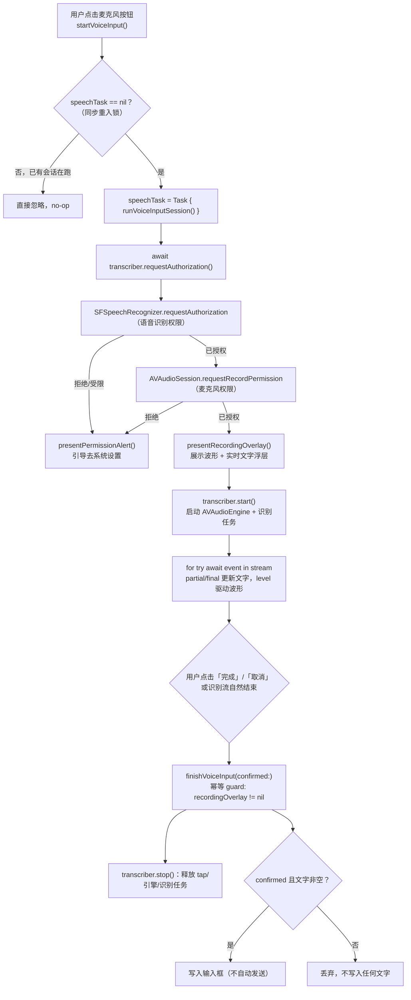
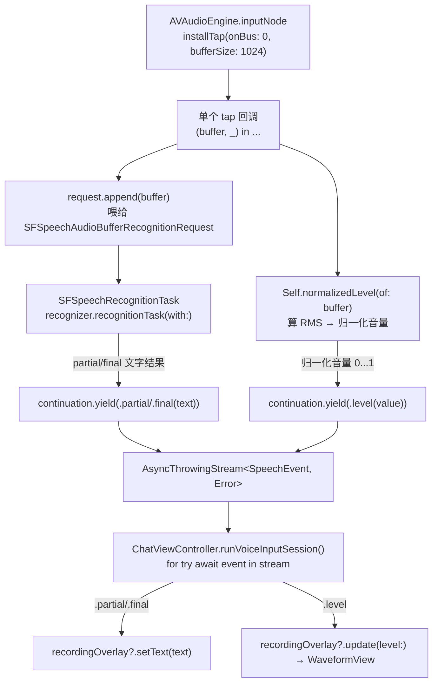

# 04 语音输入

语音输入把识别结果写入输入框而**不直接发送**，用户可以先检查/编辑再手动发送，这是与"语音直接触发对话"类应用的一个刻意的产品差异。实现集中在 `Core/Speech/SpeechTranscriber.swift`（协议 + 系统实现）与 `ChatViewController` 的语音相关方法、`RecordingOverlayView`/`WaveformView`（UI）。

## 1. 权限双授权流程图

语音识别需要两套独立权限：**语音识别权限**（`SFSpeechRecognizer`）与**麦克风权限**（`AVAudioSession`），缺一不可，且必须先后申请（先语音识别、语音识别被拒时不再多此一举去问麦克风）。



### 两个并发安全点

1. **`speechTask == nil` 的同步重入锁**（流程图里的 B）：`requestAuthorization()` 即便用户此前已经授权过，仍然是一次异步调用——`await` 期间如果只靠 `recordingOverlay`（异步赋值的浮层）判断是否已经在录音，快速双击麦克风按钮会让两个 `Task` 都通过检查，最终对同一个 `SystemSpeechTranscriber` 单例重复调用 `start()`，在同一条音频 bus 上装两次 tap——`AVAudioEngine` 每条 bus 只允许一个 tap，直接抛异常崩溃。`speechTask` 在 `guard` 检查的同一个同步执行段里被赋值，中间没有让出线程的机会，第二次调用一定能看到非 `nil` 的 `speechTask` 而被拦下。这是 Task 19 审查发现的 Critical 缺陷之一。
2. **`finishVoiceInput` 的幂等 guard**（流程图里的 L）：点击"完成"后，识别流的 `for try await` 循环不会立刻退出——要等 `stop()` 的效果异步反映到流上（`continuation.onTermination` → 引擎停止 → 迭代结束）。这段等待期间，循环收尾处原本会**无条件**再调一次收尾逻辑，导致同一段文字被拼接两次；如果流以抛错方式结束（比如识别任务被取消触发的收尾噪音），还会误弹"识别失败"提示，即便用户操作明明是成功点了"完成"。同样，点"取消"后若收尾逻辑不做幂等判断，也会被自然结束的分支误当作"确认"写入文字，直接违反"取消不写入任何文字"的产品要求。`finishVoiceInput` 用 `recordingOverlay != nil` 作为门槛：不管是按钮触发还是流自然收尾触发，两条路径谁先到达都只有第一次真正生效，后到的直接 no-op。这也是 Task 19 审查发现的另一处 Critical。

## 2. 音频管线图：一路 tap 两用

`SystemSpeechTranscriber.start()` 只在 `AVAudioEngine.inputNode` 上装了**一个** tap，这一路 PCM 数据同时喂给识别请求和音量计算，而不是开两个 tap 分别服务——避免两路 tap 抢占同一个音频硬件输入可能带来的资源冲突。



`SpeechEvent` 是抹平了"文字"与"音量"两种不同性质数据的统一事件类型：

```swift
enum SpeechEvent: Equatable {
    case partial(String)
    case final(String)
    case level(Float)
}
```

消费端（`ChatViewController.runVoiceInputSession()`）用一个 `for try await event in stream` 循环、一次 `switch` 分派到文字更新与波形更新两条路径，不需要维护两个并行的异步序列。

## 3. RMS 转波形的算法

音量计算是标准的均方根（RMS）转分贝再归一化：

```swift
private static func normalizedLevel(of buffer: AVAudioPCMBuffer) -> Float {
    guard let channel = buffer.floatChannelData?[0] else { return 0 }
    let count = Int(buffer.frameLength)
    guard count > 0 else { return 0 }

    var sum: Float = 0
    for index in 0..<count {
        sum += channel[index] * channel[index]
    }
    let rms = sqrt(sum / Float(count))
    let decibels = 20 * log10(max(rms, .leastNormalMagnitude))
    let floor: Float = -50
    return max(0, min(1, (decibels - floor) / -floor))
}
```

步骤：

1. 取单声道（`floatChannelData?[0]`）的 PCM 采样点，逐点平方求和再除以采样点数、开方，得到 RMS（均方根振幅）。
2. RMS 转分贝：`20 * log10(rms)`，用 `.leastNormalMagnitude` 兜底避免 `log10(0)` 产生 `-inf`。
3. 以 `-50dB` 作为"静音底"，把分贝值线性映射到 `0...1`：`(decibels - floor) / -floor`，再用 `max(0, min(1, ...))` 钳制到合法区间。`-50dB` 是一个经验取值——数字麦克风的背景噪声通常在这个量级以下，实际说话音量大多落在这个底线之上，用它归一化能让波形在日常说话音量下有足够的动态范围，而不是常年顶格或常年趴底。

`WaveformView.update(level:)` 接到归一化后的值，做的是"新音量从右侧推入、整体左移"的滚动柱状图：

```swift
func update(level: Float) {
    levels.removeFirst()
    levels.append(max(0.05, min(1, level)))
    setNeedsDisplay()
}
```

固定长度（`barCount = 32`）的数组模拟一个滑动窗口，`removeFirst()` + `append(_:)` 是最简单的实现方式；`max(0.05, ...)` 保证静音时柱子也有一个可见的最小高度（不会完全消失成一条线），视觉上更接近真实录音 App 的观感。`draw(_:)` 里按固定柱宽 + 间距逐个绘制圆角矩形，不涉及任何动画层，全靠 `setNeedsDisplay()` 触发的重绘节奏（与音频回调频率一致，约每 1024 帧一次）驱动视觉更新。

## 4. 端上识别与在线识别的取舍

`SFSpeechAudioBufferRecognitionRequest` 上有一个开关：

```swift
request.requiresOnDeviceRecognition = recognizer.supportsOnDeviceRecognition
```

这里没有强制要求端上识别，而是"如果这台设备/这个语言支持端上识别，就优先用端上；不支持就自动回落到在线识别"。取舍考虑：

- **端上识别（on-device）**：不经过网络，延迟更低，隐私性更好（音频不出设备），但依赖机型算力与语言模型是否已下载到本地，并非所有设备/语言组合都支持。
- **在线识别（server-based）**：覆盖面更广、通常准确率更高（尤其对生僻词、专有名词），但依赖网络连接，且有隐私上传的考量，延迟也更高。

用 `recognizer.supportsOnDeviceRecognition` 做能力探测、按需自动切换，而不是让用户在设置里手动选择，是因为这个能力本质上是"设备/系统版本/语言包是否就绪"决定的客观事实，暴露给用户一个可能大部分时候都不可用的选项没有意义；自动回落保证了功能在所有支持 `Speech` 框架的设备上都"可用"，只是端上识别可用时体验更好（更低延迟）。

## 5. 会话生命周期与资源清理

`stop()` 的清理顺序覆盖了 tap、引擎、识别请求、识别任务、音频会话五个资源，且对"重复调用"是安全的：

```swift
func stop() {
    audioEngine.inputNode.removeTap(onBus: 0)     // 未装 tap 时是文档保证的空操作
    if audioEngine.isRunning { audioEngine.stop() }
    request?.endAudio()
    task?.cancel()
    request = nil
    task = nil
    try? AVAudioSession.sharedInstance().setActive(false, options: .notifyOthersOnDeactivation)
}
```

`removeTap(onBus:)` 在没有装过 tap 时是 Apple 文档保证的空操作而非崩溃，这让 `stop()` 可以在各种时序下被安全地重复调用（比如识别流自身出错触发 `continuation.onTermination` 里的 `stop()`，随后用户点击的"取消"按钮又调用一次）。`audioEngine.start()` 抛错时，`continuation.finish(throwing:)` 会被立即调用，进而触发 `onTermination` 回调，仍然会执行到 `stop()` 完成 tap 清理——不会因为启动失败而遗留一个装了 tap 但引擎没跑起来的半吊子状态。
