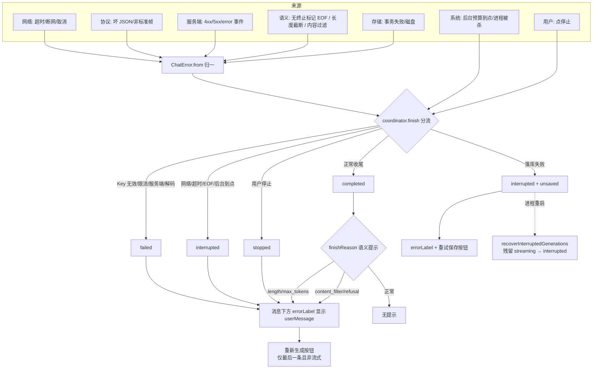
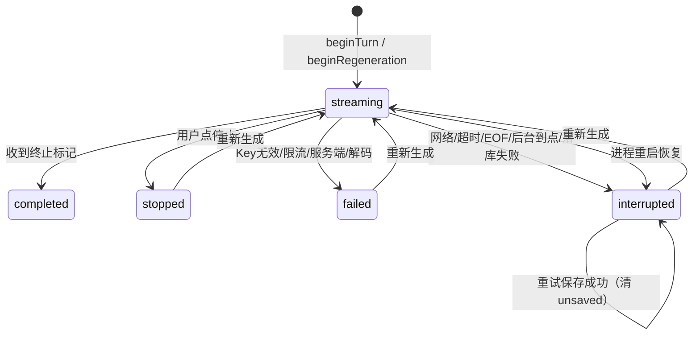

# 06 异常处理与恢复

> 本篇把分散在 `ChatError`、`ChatGenerationCoordinator`、`ChatRepository`、`ChatViewController` 四处的异常处理收成一条纵向链路。流式性能见 `doc/05`，SSE 链路细节见 `doc/01`。

## 1. 一张纵向图

流式聊天的异常处理难点不在「怎么 catch」，而在**一条已经吐出半截内容的流失败时，这半截内容归谁、用户能做什么**。本项目的答案是：

- 已生成的内容**永不丢弃**，只改状态；
- 失败分两类——`failed`（基本不可能靠重试解决，如 Key 无效）与 `interrupted`（连接层问题，内容有保留价值）；
- 每种终态都有明确的 `endReason`，日志与 UI 都从它推导。



## 2. 已落地的机制

### 2.1 归一与分类

**① 错误类型单一入口 + 文案集中**
`ChatError` 11 个 case，所有面向用户的中文文案集中在 `userMessage`（[ChatError.swift:17](WBChatApp-UIKit/Core/LLM/ChatError.swift:17)）。

- *为什么集中*：① 后续接本地化只改这一处；② 避免同一种错误在网络层、协调层、UI 层各写一套不同措辞。
- 文案一律写成**用户能做什么**，不是技术描述：`missingAPIKey` → 「还没有配置 API Key，去设置里填一个吧」，不是「401 Unauthorized」。

**② `ChatError.from` 收口第三方错误**
`URLError` / `CancellationError` / `DecodingError` 在这里归一（[ChatError.swift:51](WBChatApp-UIKit/Core/LLM/ChatError.swift:51)）。`URLError.cancelled` 与 `.timedOut` 单独分流——前者是正常取消不该报错，后者要和服务端超时区分开。

**③ HTTP 状态码分流**
`SSEStream.validate` 按状态码直接抛对应 `ChatError`（[SSEStream.swift:144](WBChatApp-UIKit/Core/Networking/SSEStream.swift:144)）：401/403 → `unauthorized`；429 → `rateLimited(retryAfter:)`，并读 `Retry-After` 头；其余 → `serverError(status:)`。

**④ 解码容错分层**
同一个 adapter 里对「JSON 本身坏」与「JSON 合法但字段缺失」给了不同待遇（[AnthropicAdapter.swift:50](WBChatApp-UIKit/Core/LLM/AnthropicAdapter.swift:50)、[:76](WBChatApp-UIKit/Core/LLM/AnthropicAdapter.swift:76)）：

- JSON 解析失败 → 抛 `ChatError.decoding`，不能静默；
- JSON 合法但 `usage` 缺失 → 走默认值 0 / 沿用旧值，这是正常情况（服务商不保证每帧都带 usage）。

*为什么要分*：如果把「字段缺失」也当错误，接国内各家 OpenAI 兼容代理时会频繁误报；如果把「JSON 坏」也容错，会吐出基于陈旧值拼出的幽灵 usage 事件。
Anthropic 的 `error` 事件（HTTP 200 但 body 里报错）单独处理，把服务端 message 带给用户（[AnthropicAdapter.swift:87](WBChatApp-UIKit/Core/LLM/AnthropicAdapter.swift:87)）。

### 2.2 流级终止判定

**⑤ 「流结束」和「流成功结束」是两件事**
`SemanticStreamProgress` actor 分别跟踪三件事（[NetworkChatProvider.swift:135](WBChatApp-UIKit/Core/LLM/NetworkChatProvider.swift:135)）：收到 `finishReason`、收到终止标记（`[DONE]` / `message_stop`）、传输自然结束。

传输结束但没见过任何终止信号 → 判 `unexpectedEOF` → `interrupted`，已生成内容保留（[ChatGenerationCoordinator.swift:183](WBChatApp-UIKit/Core/Generation/ChatGenerationCoordinator.swift:183)）。

- *为什么重要*：代理层断连、服务端 502 重写响应都会表现为「连接干净地关了，但回复只写了一半」。如果按「流结束 = 成功」处理，用户会以为模型就回答了这么多，这是最隐蔽的一类错误。

**⑥ usage 尾部 2s 宽限**
已拿到 `finishReason` 但服务端还没发 usage 帧时，等最多 2s 再收尾（`usageTailTimeout`，[NetworkChatProvider.swift:193](WBChatApp-UIKit/Core/LLM/NetworkChatProvider.swift:193) 的 `monitor`）。既不无限等，也不把「正在发尾帧」误判成中断。

**⑦ 成功不可被清理阶段的错误改写**
已成功终止后，取消 reader 只是释放传输；此时产生的取消/网络错误**不得**把已确认的成功改写成失败——`hasCompletedSuccessfully` 守卫（[NetworkChatProvider.swift:81](WBChatApp-UIKit/Core/LLM/NetworkChatProvider.swift:81)）。

- *为什么*：这是并发清理里最容易出的 bug——流明明成功了，却因为收尾时 `producer.cancel()` 抛了 `CancellationError` 而被标成失败。

**⑧ 语义进度超时与网络空闲超时分开**
见 `doc/05` 第 2.1 节②。只收心跳不出 token 照样会超时，守的是「模型侧卡死但连接健康」。

**⑨ `finishReason` 的语义化提示**
正常完成也可能需要提示用户（[ChatGenerationCoordinator.swift:265](WBChatApp-UIKit/Core/Generation/ChatGenerationCoordinator.swift:265)）：

| finishReason | 提示 |
| --- | --- |
| `length` / `max_tokens` | 已达到输出长度限制，回复可能未完整 |
| `content_filter` / `refusal` | 回复受到内容限制 |

- *为什么*：这两种都是 HTTP 200 + 流正常结束，不是错误，但用户必须知道回复为什么断在这里。

### 2.3 落库一致性

**⑩ 写入 CAS（三重校验）**
`saveGeneration` 在一个写事务里校验三件事，任一不满足就返回 `false` 不写（[ChatRepository.swift:162](WBChatApp-UIKit/Core/Persistence/ChatRepository.swift:162)）：

1. `generationID` 与库里当前一致 —— 防止上一轮的延迟写覆盖新一轮；
2. 库里当前状态仍是 `streaming` —— 防止已落定的终态被旧快照改回去；
3. `snapshotSequence` 严格递增 —— 防止乱序写。

- *为什么需要*：写库在独立串行队列上异步进行（`doc/05` 第 2.7 节），而「用户点停止 → 立刻重新生成」这类操作会让两轮生成的写请求在队列里前后排队。只靠队列顺序不足以保证正确性，必须在数据库层面也做一道校验。队列顺序 + CAS 共同保护终态。

**⑪ 1s 周期 checkpoint**
`checkpointTask` 每秒落一次盘（[ChatGenerationCoordinator.swift:169](WBChatApp-UIKit/Core/Generation/ChatGenerationCoordinator.swift:169)），`dirty` 标志保证没变化就不写（[:281](WBChatApp-UIKit/Core/Generation/ChatGenerationCoordinator.swift:281)）。

- *权衡*：崩溃/被杀最多丢 1s 内容，换来写放大从「每 token 一次事务」降到约 1/50。这是明确接受的取舍。

**⑫ 落库失败是终止事件，不是忽略事件**
checkpoint 失败后（[:299](WBChatApp-UIKit/Core/Generation/ChatGenerationCoordinator.swift:299)）：立刻停流、取消网络与 checkpoint 任务、标 `unsaved = true`、状态改 `interrupted`、`endReason = storageFailure`，UI 的按钮文案从「重新生成」切成「重试保存」（[ChatViewController.swift:195](WBChatApp-UIKit/Features/Chat/ChatViewController.swift:195)），走 `retrySave()`（[ChatGenerationCoordinator.swift:316](WBChatApp-UIKit/Core/Generation/ChatGenerationCoordinator.swift:316)）。

- *为什么不继续生成*：既然写不进去，继续生成只会积累更多写不进去的内容，崩溃时全丢。停下来并把「内容还在内存里、请重试保存」明确告诉用户，是唯一诚实的处理。
- `unsaved` 期间 `canSend` 为 false（[ChatViewModel.swift:169](WBChatApp-UIKit/Features/Chat/ChatViewModel.swift:169)），不允许开新一轮覆盖掉未保存内容。

**⑬ 并发保存收口**
新一轮生成开始前，如果上一轮还有 `pendingSaves`，会挂起等待（`saveWaiters`，[ChatGenerationCoordinator.swift:141](WBChatApp-UIKit/Core/Generation/ChatGenerationCoordinator.swift:141)、[:288](WBChatApp-UIKit/Core/Generation/ChatGenerationCoordinator.swift:288)）；等待期间先占住「准备中」名额，避免第二次点击也开事务。等完若上一轮是 `unsaved`，直接抛 `ChatError.storage` 不开新轮。

**⑭ 进程重启恢复**
App 启动时把库里残留的 `streaming` 行批量改为 `interrupted`、`endReason = processRestart`、文案「上次生成已中断，可重新生成」（[ChatRepository.swift:177](WBChatApp-UIKit/Core/Persistence/ChatRepository.swift:177)，由 `AppContainer.open()` 在后台线程调用）。

- *为什么必须有*：进程被杀时没有任何代码有机会收尾，库里会留下永远是 `streaming` 的僵尸行——UI 会显示「正在生成」却永远不动，而且 `saveGeneration` 的 CAS 第 2 条会把后续写入全部挡掉。

**⑮ 删除会话失败的回滚**
删除会话时 `begin` 事务可能已经提交但删除意图作废（[ChatGenerationCoordinator.swift:339](WBChatApp-UIKit/Core/Generation/ChatGenerationCoordinator.swift:339)）：重新读库，若发现残留 `streaming` 行就重建 Session 并 `finish(.interrupted, "deleteFailed")`，不留僵尸行，然后把错误抛给调用方。

### 2.4 生命周期与资源

**⑯ 后台 20s 预算**
进入后台时 `persist` 全部会话并申请后台执行（[ChatGenerationCoordinator.swift:361](WBChatApp-UIKit/Core/Generation/ChatGenerationCoordinator.swift:361)）；20s 到点或系统提前回收 → `finish(.interrupted, "backgroundExpired")` 并给专门文案「后台运行时间已结束，回复未完成」（[:264](WBChatApp-UIKit/Core/Generation/ChatGenerationCoordinator.swift:264)、[:390](WBChatApp-UIKit/Core/Generation/ChatGenerationCoordinator.swift:390)）。后台期间**拒绝**新生成（[:128](WBChatApp-UIKit/Core/Generation/ChatGenerationCoordinator.swift:128)）。

- `backgroundEpoch` 计数防止「回前台又切后台」时旧的定时器误触发（[:384](WBChatApp-UIKit/Core/Generation/ChatGenerationCoordinator.swift:384)）。
- `expiredPreparing` 处理一个细致的竞态：预算到点时某轮生成的数据库事务还在准备中，它还没进 `sessions` 所以 `expireBackground` 收不到它——用这个集合记下，事务一提交就立刻收尾（[:163](WBChatApp-UIKit/Core/Generation/ChatGenerationCoordinator.swift:163)、[:391](WBChatApp-UIKit/Core/Generation/ChatGenerationCoordinator.swift:391)）。
- 空闲即释放后台资源（[:398](WBChatApp-UIKit/Core/Generation/ChatGenerationCoordinator.swift:398)）。

**⑰ 并发生成上限 3**
超过就报 `generationLimit`（[ChatGenerationCoordinator.swift:125](WBChatApp-UIKit/Core/Generation/ChatGenerationCoordinator.swift:125)），计数包含「准备中」的名额。守的是后台预算与内存——三条流同时跑已经是移动端的合理上限。

**⑱ 语音链路的三道防护**（[ChatViewController.swift:449](WBChatApp-UIKit/Features/Chat/ChatViewController.swift:449) 起）

| 问题 | 处理 |
| --- | --- |
| 权限被拒 | 弹窗引导去「设置 → 隐私」，不静默失败 |
| 快速双击麦克风 | `speechTask` 做**同步**重入锁——`requestAuthorization()` 即便已授权也是异步调用，只靠 overlay 判断会让两个 Task 都通过，对同一条 audio bus 装两次 tap 直接崩溃 |
| `stop()` 引发的收尾报错 | 用 `recordingOverlay != nil` 当幂等门槛（[:485](WBChatApp-UIKit/Features/Chat/ChatViewController.swift:485)、[:518](WBChatApp-UIKit/Features/Chat/ChatViewController.swift:518)）：用户已点过完成/取消时，这次抛错只是噪音，不能再弹「语音识别失败」误导用户 |

识别结果写进输入框而**不直接发送**，用户可以先改再发。

**⑲ 前后台的 UI 一致性**
切后台停合帧、回前台 `loadHistory()` 重建（[ChatViewModel.swift:88](WBChatApp-UIKit/Features/Chat/ChatViewModel.swift:88)）。后台期间 coordinator 仍在收 token 并更新快照，但 UI 不排版；回前台时用 `loadHistory` 整体重建而不是继续打补丁——因为中间漏掉的帧无法补，重建是唯一正确的做法。

### 2.5 UI 呈现与重试

**⑳ 错误分两级呈现**

| 级别 | 呈现方式 | 位置 |
| --- | --- | --- |
| 消息级（这条回复失败了） | 该条消息下方红色 `errorLabel` + 条件性按钮 | [AssistantMessageCell.swift:93](WBChatApp-UIKit/Features/Chat/Views/AssistantMessageCell.swift:93) |
| 会话级（存储不可用、并发超限） | 弹 alert | [ChatViewController.swift:242](WBChatApp-UIKit/Features/Chat/ChatViewController.swift:242) |

- *为什么分*：消息级错误是「这条内容的一部分」，滚上去还能看到，弹窗会打断用户；会话级错误与具体消息无关，必须立刻拦住用户。

**㉑ 重试入口的两道校验**
消息底部操作栏的「重新生成」只在「最后一条助手消息 + 可发送」时出现，落库失败时换成「重试保存」（`ChatViewController.trailingAction(for:)`）；点击时**再用点击那一刻最新的 state 复核一次**（[ChatViewController.swift:399](WBChatApp-UIKit/Features/Chat/ChatViewController.swift:399)）。

- *为什么要复核*：cell 复用会让按钮残留在一条已经不是最后一条的消息上，而 `retryLast()` 内部永远操作 `messages.last`——不复核就会出现「点 A 的按钮，重试了 B」。显隐判断与点击复核用的是同一套标准。

**㉒ 重新生成前必须先清空块视图**
`retryLast()` 起新流之前，ViewModel 先发 `blocksReset`（[ChatViewModel.swift:102](WBChatApp-UIKit/Features/Chat/ChatViewModel.swift:102)），VC 清空对应 cell 的块视图（[ChatViewController.swift:282](WBChatApp-UIKit/Features/Chat/ChatViewController.swift:282)），`AssistantMessageCell.resetBlocks` 同时立刻隐藏操作栏按钮（操作栏本身保持占位）。

- *为什么*：不清空的话，下一帧补丁到达时 `applyPatch` 顶部的「上一帧未闭合块」特判会因 `hasOpenBlock == false` 整段跳过，新内容被 append 在旧的失败内容之后，产生重复错位显示。按钮不隐藏的话，流式期间它会一直留在屏上且点了被静默吞掉，操作栏始终占位，行高不随按钮显隐变化。

### 2.6 契约防御

**㉓ Debug 快速失败，Release 安全退化**

- `BlockStackView.applyPatch` 对「有新闭合块但 ordinal 与上一帧 open 块不匹配、且本帧还带新 open 块」这种**契约外输入** `assertionFailure`（[BlockStackView.swift:102](WBChatApp-UIKit/Features/Chat/Views/BlockStackView.swift:102)）：真实 splitter 驱动下不可达，但一旦未来有人错误地部分重置切块器，继续往下走会静默破坏「已闭合块只增不改」。Debug 直接崩，Release 下 `assertionFailure` 是空操作，行为退化为「维持上一帧不变」，不新增风险。
- `applyPatch` 的 messageID 一致性 `assert`（[ChatViewController.swift:300](WBChatApp-UIKit/Features/Chat/ChatViewController.swift:300)）：补丁打到另一条消息上属于状态更新顺序被打乱，提前暴露而不是让 UI 静默错位。

*这类断言的价值*：它们守的不是用户输入，而是**模块之间的不变量**。守不住时的后果是「不崩溃但显示错内容」，这类 bug 最难在测试里发现，所以要在开发期就崩掉。

## 3. 五态状态机与 `endReason`



`endReason` 是终态的唯一诊断依据，取值表：

| endReason | 对应状态 | 触发点 | 内容保留 | 用户可做 |
| --- | --- | --- | --- | --- |
| 服务商 `finishReason`（`stop`/`length`/…） | completed | 正常收尾 | ✅ | `length` 等有额外提示 |
| `completed` | completed | 收到终止标记但服务商没给 reason | ✅ | — |
| `userStopped` | stopped | `stop()` | ✅ | 重新生成 |
| `unexpectedEOF` | interrupted | 传输结束但无终止标记 | ✅ | 重新生成 |
| `connectionInterrupted` | interrupted | 网络 / 超时 / 取消 | ✅ | 重新生成 |
| `requestFailed` | failed | Key 无效 / 限流 / 服务端 / 解码 | ✅ | 改设置后重新生成 |
| `backgroundExpired` | interrupted | 后台预算到点 | ✅ | 重新生成 |
| `storageFailure` | interrupted + unsaved | checkpoint 写库失败 | ⚠️ 仅在内存 | **重试保存** |
| `processRestart` | interrupted | 启动时清理残留 streaming | ✅ 到最后一次 checkpoint | 重新生成 |
| `deleteFailed` | interrupted | 删除会话失败后的收尾 | ✅ | 重新生成 |

注意 `storageFailure` 是唯一「内容不在库里」的终态，所以它的恢复动作不是重新生成（那会丢掉内容）而是重试保存。

## 4. 还能优化的地方

按风险从高到低。

### 4.1 服务端错误体从未被读取（风险最高）

`SSEStream.validate` 只看状态码和 `Retry-After`，**不读错误响应体**——`session.bytes(for:)` 拿到的只是首个响应头到达时的 `URLResponse`，body 还没被消费，所以 `ChatError.serverError` 的 `message` 恒为 `nil`（[SSEStream.swift:139](WBChatApp-UIKit/Core/Networking/SSEStream.swift:139) 的注释已经点明）。

后果：用户遇到 400/404 只看到「服务端错误（400）」，而服务端返回的 `{"error":{"message":"model 'xxx' does not exist"}}`、「余额不足」、「该 Key 无权访问此模型」这类**唯一可操作的信息**被整条丢弃。这是目前最影响排障体验的一处。

- **改法**：非 2xx 时在 `validate` 抛错前先消费 body（限长，比如 8KB 上限防御超大响应），按两家协议的 error envelope 解析出 message 塞进 `serverError`。`AnthropicDTO.ErrorEnvelope` 已经存在可以复用（[AnthropicAdapter.swift:88](WBChatApp-UIKit/Core/LLM/AnthropicAdapter.swift:88)）。
- **注意**：`validate` 当前是同步函数，要改成 async 并调整调用处的任务组结构；body 可能是 HTML（代理层报错），解析失败要退回只报状态码。

### 4.2 没有任何自动重试与退避

429 带了 `Retry-After` 却只用来拼文案（[ChatError.swift:23](WBChatApp-UIKit/Core/LLM/ChatError.swift:23)）；首字节前的网络瞬断也不重连。弱网下用户要手动点好几次「重新生成」。

- **改法**：只对「尚未吐出任何 token」的失败做有限次指数退避重试（429 优先用 `Retry-After` 的值）。**已经出字的流不自动重试**——重试会从头生成，拼在已有内容后面就是重复，替换掉又违反「内容永不丢弃」，所以保持现在的「保留 + 让用户决定」语义。
- **位置**：加在 `ChatGenerationCoordinator.begin` 的 session.task 里，而不是 provider 层——因为「有没有出过字」只有 coordinator 知道（`session.replaced`）。
- **风险**：中。要确保重试次数、退避上限、用户点停止能立刻中断重试循环。

### 4.3 单帧坏 JSON 直接终止整条流

两家 adapter 对坏帧都抛 `ChatError.decoding`（[OpenAICompatibleAdapter.swift:51](WBChatApp-UIKit/Core/LLM/OpenAICompatibleAdapter.swift:51)、[AnthropicAdapter.swift:51](WBChatApp-UIKit/Core/LLM/AnthropicAdapter.swift:51)），而第三方 OpenAI 兼容代理插入非标准帧、自定义心跳、甚至带 BOM 的帧都很常见。一帧坏掉就让整轮生成 `failed`，过于严格。

- **改法**：区分帧的关键性——`usage` / 未知 `event` 类型解析失败就跳过并计数，只有连续 N 帧（如 5 帧）失败或**正文帧**解析失败才终止。计数器放在 mapper 里。
- **风险**：中。放松之后要防止「一直跳过坏帧 → 流看似健康但一个字都不出」，不过这个场景已经被语义进度超时（180s）兜住了。

### 4.4 一批 `try?` 吞掉的错误

| 位置 | 吞掉了什么 | 后果 |
| --- | --- | --- |
| [ConversationListViewModel.swift:58](WBChatApp-UIKit/Features/ConversationList/ConversationListViewModel.swift:58) | 建会话失败 | 返回空 id；[ConversationListViewController.swift:104](WBChatApp-UIKit/Features/ConversationList/ConversationListViewController.swift:104) 的注释已承认后续发消息会因外键约束静默丢库 |
| [:74](WBChatApp-UIKit/Features/ConversationList/ConversationListViewModel.swift:74) | 重命名失败 | UI 显示新名字，库里还是旧的，下次刷新又变回去 |
| [:79](WBChatApp-UIKit/Features/ConversationList/ConversationListViewModel.swift:79) | 读列表失败 | 列表显示为空，与「真的没有会话」无法区分 |
| [SettingsViewModel.swift:73](WBChatApp-UIKit/Features/Settings/SettingsViewModel.swift:73) | 写 Keychain 失败 | 用户以为 Key 存好了，下次启动又是演示模式 |

- **改法**：这四处都改成上抛 + 明确提示。聊天主链路（coordinator）的错误处理已经做得比较完整，这几处是对比之下的短板，统一到同一水准。
- **风险**：低，纯粹是补提示。

### 4.5 可重试性判定没有单一事实来源

「哪些错误算 `interrupted`（内容有价值）、哪些算 `failed`」硬编码在 coordinator 的一个 switch 里（[ChatGenerationCoordinator.swift:191](WBChatApp-UIKit/Core/Generation/ChatGenerationCoordinator.swift:191)）：

```swift
case .network, .timeout, .interruptedStream, .cancelled: interrupted = true
default: interrupted = false
```

新增 `ChatError` case 时，编译器不会提醒这里要同步（有 `default` 兜底），容易漏。

- **改法**：在 `ChatError` 上加 `var isConnectionLevel: Bool` / `var isRetryable: Bool` 计算属性，用穷尽 switch（去掉 `default`）让编译器强制每个新 case 都做决定。4.2 的自动重试判定也可以直接复用。
- **风险**：极低，纯重构。

### 4.6 用户主动停止与底层取消在日志里混淆

`stop()` 走 `finish(.stopped, "userStopped")`（[ChatGenerationCoordinator.swift:249](WBChatApp-UIKit/Core/Generation/ChatGenerationCoordinator.swift:249)）；但 provider 侧抛出的 `.cancelled` 落进 interrupted 分支，`endReason` 会记成 `connectionInterrupted`（[:193](WBChatApp-UIKit/Core/Generation/ChatGenerationCoordinator.swift:193)）。

实际执行顺序上 `stop()` 先把 `running = false`，后续的 `isCurrent` 守卫会让 provider 的错误被丢弃，所以**用户可见的状态是对的**；但如果取消来自其他路径（如 `deleteConversation` 取消任务），日志里会出现误导性的 `connectionInterrupted`。

- **改法**：`.cancelled` 单独分流到一个 `endReason`（如 `taskCancelled`），与网络中断区分。
- **风险**：极低。属于可观测性修补，不改用户行为。

### 4.7 日志与可观测性薄弱

- 全项目只有一个 `Logger(subsystem: "WBChatApp", category: "Generation")`（[ChatGenerationCoordinator.swift:65](WBChatApp-UIKit/Core/Generation/ChatGenerationCoordinator.swift:65)）；
- `GRDBChatRepository.observeConversations` 用 `print` 而不是 `Logger`（[ChatRepository.swift:62](WBChatApp-UIKit/Core/Persistence/ChatRepository.swift:62)）；
- 没有错误计数、没有非致命上报，无法回答「用户最常遇到哪类失败」。

- **改法**：① 按 `Networking` / `Persistence` / `Speech` 分 category 统一到 OSLog；② 错误日志带上状态码与 `endReason` 这两个可聚合维度。
- **安全注意**：`ChatError.decoding(String)` 携带原始报文（[ChatError.swift:12](WBChatApp-UIKit/Core/LLM/ChatError.swift:12)），里面可能有用户对话内容。目前 `userMessage` 不显示它，日志里也没打印，但**一旦加日志必须先截断 + 脱敏**，并且按 AGENTS.md 的要求绝不输出任何密钥。OSLog 的 `privacy: .public` 只能用在确定无敏感信息的字段上（现有代码里只有 `reason` 用了 `.public`，是正确的）。

### 4.8 缺少网络可达性区分

`.network(code:)` 给用户的只有一句「网络连接失败，请检查网络后重试」，但「飞行模式」和「API 域名被墙 / 服务挂了」需要完全不同的行动。

- **改法**：引入 `NWPathMonitor`，无网络时文案改为「当前无网络连接」，并在恢复联网时给出可重试提示（甚至配合 4.2 自动重试一次）。
- **风险**：低。注意 monitor 要正确释放，别成为常驻耗电源。

### 4.9 存储失败只有一次性「重试保存」

`retrySave` 失败就只是再报一次 `.storage`（[ChatGenerationCoordinator.swift:329](WBChatApp-UIKit/Core/Generation/ChatGenerationCoordinator.swift:329)），没有自动重试、没有降级落盘。磁盘满或数据库被锁时，内存里那份内容仍可能随 App 退出而丢失。

- **改法（按成本递增）**：① 退避重试 2~3 次（SQLite 锁冲突通常是瞬时的）；② 降级写到临时文件，下次启动时尝试恢复；③ 磁盘空间不足单独识别并给专门文案。
- **风险**：②要设计恢复流程与文件清理，中等。

### 4.10 后台预算固定 20s 且无续期路径

`backgroundLimit` 硬编码 20s（[ChatGenerationCoordinator.swift:72](WBChatApp-UIKit/Core/Generation/ChatGenerationCoordinator.swift:72)），未用 `BGTaskScheduler`；到点前不提示用户；回前台后只能「重新生成」——丢弃已生成的增量重新来一遍。

- **改法**：① 用 `UIApplication.shared.backgroundTimeRemaining` 动态取预算而不是写死 20s；② 到点前几秒给本地通知提示「回到 App 以继续生成」；③ 回前台后提供「接着生成」——把已生成内容作为 assistant 前缀续写（需要服务商支持 prefix continuation，OpenAI 兼容协议可以用 assistant 消息结尾 + `continue` 语义模拟，效果取决于服务商）。
- **风险**：③效果不保证且各家行为不一致，属于「可探索」而非「应该做」。①②成本低收益确定，优先。

### 4.11 错误路径缺端到端 UI 测试

401 / 429 / 坏 JSON 的提示文案与重试按钮可见性目前只有单测覆盖（`NetworkChatProviderTests`、`ChatGenerationCoordinatorTests`、`GenerationPersistenceTests`），没有 UI 测试验证「用户真的能看到并点到」。按 AGENTS.md 的测试规范，这类「必须启动 App 才能验证的交互流程」正是 UI 测试的适用范围。

- **改法**：在 `WBChatApp-UIKitUITests` 加一条：注入会立刻失败的 provider，断言 `message.retry` 按钮可见（accessibilityIdentifier 已经有了，[AssistantMessageCell.swift:43](WBChatApp-UIKit/Features/Chat/Views/AssistantMessageCell.swift:43)）并点击后状态正确变化。
- **风险**：低，但需要一个注入失败 provider 的启动参数通道。

## 5. 文件行号索引

| 主题 | 位置 |
| --- | --- |
| `ChatError` 定义与文案 | [ChatError.swift:3](WBChatApp-UIKit/Core/LLM/ChatError.swift:3)、[:17](WBChatApp-UIKit/Core/LLM/ChatError.swift:17) |
| 第三方错误归一 | [ChatError.swift:51](WBChatApp-UIKit/Core/LLM/ChatError.swift:51) |
| HTTP 状态码分流 | [SSEStream.swift:144](WBChatApp-UIKit/Core/Networking/SSEStream.swift:144) |
| 服务端错误体未读（待改） | [SSEStream.swift:139](WBChatApp-UIKit/Core/Networking/SSEStream.swift:139) |
| 解码容错分层 | [AnthropicAdapter.swift:50](WBChatApp-UIKit/Core/LLM/AnthropicAdapter.swift:50)、[:76](WBChatApp-UIKit/Core/LLM/AnthropicAdapter.swift:76)、[:87](WBChatApp-UIKit/Core/LLM/AnthropicAdapter.swift:87) |
| 语义终止判定 | [NetworkChatProvider.swift:135](WBChatApp-UIKit/Core/LLM/NetworkChatProvider.swift:135)、[:183](WBChatApp-UIKit/Core/LLM/NetworkChatProvider.swift:183)、[:193](WBChatApp-UIKit/Core/LLM/NetworkChatProvider.swift:193) |
| 成功不被清理错误改写 | [NetworkChatProvider.swift:81](WBChatApp-UIKit/Core/LLM/NetworkChatProvider.swift:81) |
| 终止分流（interrupted / failed） | [ChatGenerationCoordinator.swift:188](WBChatApp-UIKit/Core/Generation/ChatGenerationCoordinator.swift:188) |
| `finish` 与 `endReason` 赋值 | [ChatGenerationCoordinator.swift:254](WBChatApp-UIKit/Core/Generation/ChatGenerationCoordinator.swift:254) |
| checkpoint 与落库失败处理 | [ChatGenerationCoordinator.swift:169](WBChatApp-UIKit/Core/Generation/ChatGenerationCoordinator.swift:169)、[:281](WBChatApp-UIKit/Core/Generation/ChatGenerationCoordinator.swift:281) |
| 重试保存 | [ChatGenerationCoordinator.swift:316](WBChatApp-UIKit/Core/Generation/ChatGenerationCoordinator.swift:316) |
| 并发保存等待 | [ChatGenerationCoordinator.swift:141](WBChatApp-UIKit/Core/Generation/ChatGenerationCoordinator.swift:141) |
| 删除失败回滚 | [ChatGenerationCoordinator.swift:339](WBChatApp-UIKit/Core/Generation/ChatGenerationCoordinator.swift:339) |
| 后台预算 | [ChatGenerationCoordinator.swift:361](WBChatApp-UIKit/Core/Generation/ChatGenerationCoordinator.swift:361)~[:402](WBChatApp-UIKit/Core/Generation/ChatGenerationCoordinator.swift:402) |
| 并发生成上限 | [ChatGenerationCoordinator.swift:125](WBChatApp-UIKit/Core/Generation/ChatGenerationCoordinator.swift:125) |
| 写入 CAS | [ChatRepository.swift:162](WBChatApp-UIKit/Core/Persistence/ChatRepository.swift:162) |
| 进程重启恢复 | [ChatRepository.swift:177](WBChatApp-UIKit/Core/Persistence/ChatRepository.swift:177) |
| 五态定义 | [Records.swift:5](WBChatApp-UIKit/Core/Persistence/Records.swift:5) |
| 错误的 UI 呈现 | [AssistantMessageCell.swift:93](WBChatApp-UIKit/Features/Chat/Views/AssistantMessageCell.swift:93)、[ChatViewController.swift:242](WBChatApp-UIKit/Features/Chat/ChatViewController.swift:242) |
| 重试按钮二次校验 | [ChatViewController.swift:399](WBChatApp-UIKit/Features/Chat/ChatViewController.swift:399) |
| 重新生成前清空块 | [ChatViewModel.swift:102](WBChatApp-UIKit/Features/Chat/ChatViewModel.swift:102)、[ChatViewController.swift:282](WBChatApp-UIKit/Features/Chat/ChatViewController.swift:282) |
| 语音链路防护 | [ChatViewController.swift:449](WBChatApp-UIKit/Features/Chat/ChatViewController.swift:449)、[:485](WBChatApp-UIKit/Features/Chat/ChatViewController.swift:485)、[:518](WBChatApp-UIKit/Features/Chat/ChatViewController.swift:518) |
| 契约断言 | [BlockStackView.swift:102](WBChatApp-UIKit/Features/Chat/Views/BlockStackView.swift:102)、[ChatViewController.swift:300](WBChatApp-UIKit/Features/Chat/ChatViewController.swift:300) |

相关测试：`NetworkChatProviderTests`、`StreamTransportIntegrationTests`、`GenerationPersistenceTests`、`ChatGenerationCoordinatorTests`、`ChatViewModelTests`、`SpeechTranscriberTests`。
