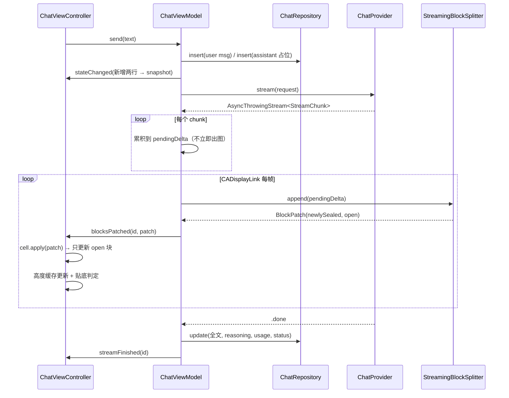
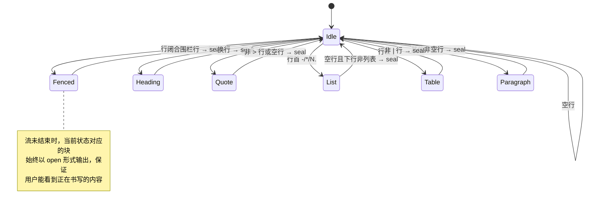
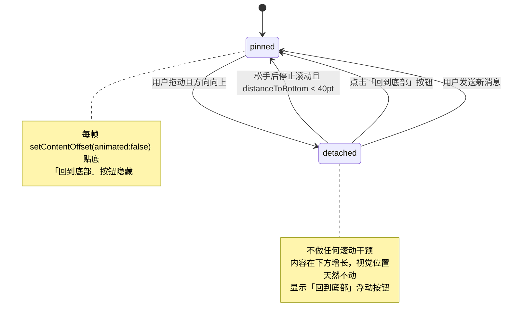

# WBChatApp-UIKit 设计规格

日期：2026-08-24
状态：待评审

## 1. 目标与定位

用 UIKit 重做一个对标 iOS 端 ChatGPT 的 AI 聊天 App，作为面试作品。不追求功能完整，追求**核心链路的工程深度**：SSE 流式输出、Markdown 块级增量渲染、流式期间的滚动手势冲突处理、双协议（OpenAI 兼容 / Anthropic）适配。

同仓库已有 SwiftUI 版本 `WBChatApp`（DeepSeek + SwiftData + MarkdownUI）。本项目是**独立的 UIKit 实现**，不复用其代码，两者形成技术对照。

### 1.1 已确认的决策

以下决策已由用户拍板，实施阶段不再重新讨论：

| 项 | 决策 |
| --- | --- |
| 最低系统 | iOS 16.0 |
| 架构 | MVVM，ViewModel 不 import UIKit |
| UI 搭建 | 纯代码 + Auto Layout，删除 Storyboard |
| 消息列表 | `UITableView` + `UITableViewDiffableDataSource` |
| Markdown 渲染 | 块级增量 + TextKit 2（`UITextView`） |
| Markdown 解析 | `swift-markdown`（Apple 官方），渲染层自研 |
| 持久化 | GRDB |
| 文档 | 一篇总览 + 四篇专题，Mermaid 绘图 |

### 1.2 依赖

| 依赖 | 用途 | 说明 |
| --- | --- | --- |
| `swiftlang/swift-markdown` | 单个 Markdown 块的 AST 解析 | 仅用其解析能力，属性串渲染自研 |
| `groue/GRDB.swift` | SQLite 持久化 | 用 `DatabaseQueue` + `ValueObservation` |

SSE 解析、代码高亮、块切分、排版、语音全部自研。

### 1.3 明确不做（YAGNI）

- 图片/文件上传、多模态
- 联网搜索、工具调用
- 账号体系、云端同步
- 消息分页加载（会话内消息量在演示规模内一次性载入）
- 导出、分享

---

## 2. 分层架构

单 target，目录即模块边界。依赖方向严格单向：`App → Features → Core → Common`，同层之间不互相引用。

```
WBChatApp-UIKit/
├── App/
│   ├── AppDelegate.swift
│   ├── SceneDelegate.swift
│   └── AppContainer.swift            依赖组装（唯一知道具体实现的地方）
├── Core/
│   ├── Networking/
│   │   ├── SSEEventParser.swift      Data 分块 → SSE 事件（纯函数，无 IO）
│   │   ├── SSEStream.swift           URLSession.bytes → AsyncThrowingStream<SSEEvent>
│   │   └── HTTPClient.swift
│   ├── LLM/
│   │   ├── ChatProvider.swift        协议 + ChatRequest/ChatMessage
│   │   ├── StreamChunk.swift         统一流式事件模型
│   │   ├── ProviderKind.swift        服务商枚举与预设
│   │   ├── OpenAICompatibleProvider.swift
│   │   ├── AnthropicProvider.swift
│   │   ├── MockProvider.swift        无 Key 时的演示模式
│   │   └── DTO/                      两家的请求/响应 Codable 模型
│   ├── Markdown/                     ★ 核心
│   │   ├── MarkdownBlock.swift       块模型（类型 + 原文 + sealed 标记 + ordinal）
│   │   ├── StreamingBlockSplitter.swift  增量切块状态机（纯函数，无 UI）
│   │   ├── BlockPatch.swift          切块输出的补丁结构
│   │   ├── AttributedRenderer.swift  单块 AST → NSAttributedString
│   │   ├── MarkdownTheme.swift       字号/行距/颜色
│   │   ├── AttributedCache.swift     属性串与高度缓存
│   │   └── CodeHighlighter.swift     轻量语法高亮
│   ├── Persistence/
│   │   ├── AppDatabase.swift         GRDB 连接与 migrator
│   │   ├── Records/                  ConversationRecord / MessageRecord
│   │   └── ChatRepository.swift      协议 + GRDB 实现
│   ├── Speech/
│   │   └── SpeechTranscriber.swift   协议 + SFSpeechRecognizer 实现
│   └── Security/
│       └── KeychainStore.swift
├── Features/
│   ├── Chat/
│   │   ├── ChatViewModel.swift
│   │   ├── ChatViewController.swift
│   │   ├── AutoScrollController.swift
│   │   └── Views/
│   │       ├── AssistantMessageCell.swift
│   │       ├── UserMessageCell.swift
│   │       ├── BlockStackView.swift      自定义竖排容器
│   │       ├── BlockViewPool.swift       块视图复用池
│   │       ├── MarkdownTextBlockView.swift
│   │       ├── CodeBlockView.swift
│   │       ├── TableBlockView.swift
│   │       ├── DividerBlockView.swift
│   │       ├── ReasoningSectionView.swift
│   │       ├── InputBarView.swift
│   │       └── ScrollToBottomButton.swift
│   ├── ConversationList/
│   │   ├── ConversationListViewModel.swift
│   │   ├── DrawerContainerViewController.swift
│   │   └── ConversationListViewController.swift
│   └── Settings/
│       ├── SettingsViewModel.swift
│       └── SettingsViewController.swift
└── Common/
    ├── Theme.swift
    ├── UIView+Layout.swift
    └── Haptics.swift
```

### 2.1 MVVM 契约

- **ViewModel** 不 `import UIKit`。持有 Repository / Provider 的**协议**，由 `AppContainer` 注入。对外暴露：
  - 只读的 `State` 值类型快照
  - 单一 `onOutput: ((Output) -> Void)?` 回调
- **ViewController** 订阅 `Output`，翻译成 UI 操作。不含业务判断。
- **Model 层**（Core）全部面向协议，可被测试替身替换。

`ChatViewModel` 的输出刻意分成两类，这是高性能流式的关键设计：

```swift
enum Output {
    case stateChanged(State)                    // 结构性变化 → diffable snapshot
    case blocksPatched(MessageID, BlockPatch)   // 流式增量 → 直接打到 cell 实例
    case streamFinished(MessageID)
    case failed(ChatError, MessageID?)
}
```

**结构性变化**（新增消息、删除、切会话）走 diffable data source 的 snapshot；**流式增量**完全绕开 data source，由 VC 取到最后一行的 cell 实例直接打补丁。二者混用是流式聊天卡顿的主因，本设计从接口层就把它们分开。

---

## 3. 流式链路与双协议适配

### 3.1 统一事件模型

```swift
enum StreamChunk {
    case textDelta(String)
    case reasoningDelta(String)      // DeepSeek reasoning_content / Anthropic thinking
    case usage(TokenUsage)
    case done(finishReason: String?)
}

protocol ChatProvider: Sendable {
    func stream(_ request: ChatRequest) -> AsyncThrowingStream<StreamChunk, Error>
}
```

上层（ViewModel 及以上）只认识 `StreamChunk`，对两家协议的差异完全无感。

### 3.2 两家协议差异对照

| | OpenAI 兼容（OpenAI / DeepSeek） | Anthropic |
| --- | --- | --- |
| 端点 | `POST /v1/chat/completions` | `POST /v1/messages` |
| 鉴权头 | `Authorization: Bearer <key>` | `x-api-key: <key>` + `anthropic-version: 2023-06-01` |
| 开启流式 | body `"stream": true` | body `"stream": true` |
| system 消息 | 放在 `messages` 数组内 | 顶层独立 `system` 字段 |
| 文本增量 | `choices[0].delta.content` | `event: content_block_delta` → `delta.text` |
| 思考增量 | `choices[0].delta.reasoning_content` | `delta.thinking`（`thinking_delta`） |
| 结束标记 | `data: [DONE]` | `event: message_stop` |
| 用量 | 末帧 `usage` 对象 | `message_delta` 的 `usage` |
| 错误 | HTTP 状态码 + JSON body | 同上，另有 `event: error` |

关键差异在于 **OpenAI 只用 `data:` 字段，Anthropic 同时使用 `event:` 与 `data:`**。因此 `SSEEventParser` 必须是完整的 SSE 规范实现（支持 `event` / `data` / `id` / `retry` / 注释行），不能只做 `data:` 前缀截取。

### 3.3 SSE 解析：分层与可测性

```
URLSession.bytes(for:)  →  [UInt8] 分块
        ↓
SSEEventParser.consume(Data) -> [SSEEvent]     ← 纯函数，无 IO，可单测
        ↓
SSEStream: AsyncThrowingStream<SSEEvent>
        ↓
XxxProvider.map(SSEEvent) -> StreamChunk?      ← 协议差异只在这一层
```

`SSEEventParser` 内部维护行缓冲，处理三类边界情况：

1. **粘包**：一次 `Data` 含多个完整事件
2. **分包**：一个事件的 `data:` 行被切成两次 `Data`，甚至 UTF-8 多字节字符被劈开（缓冲区按字节累积，仅在切出完整行时才解码）
3. **换行符**：`\n` / `\r\n` / `\r` 三种都要支持；空行分派事件；`:` 开头为注释需丢弃

### 3.4 完整流式时序



### 3.5 节流策略

网络 delta 到达频率可达每秒上百次，直接驱动 UI 会导致无意义的重复排版。采用 **CADisplayLink 合帧**：

- ViewModel 持有 `CADisplayLink`，流式开始时启动、结束时停止
- `for await chunk` 只做字符串累积（`pendingText`），不触发任何 UI
- 每帧回调把 `pendingText` 一次性喂给 splitter，产出一个 `BlockPatch` 发给 VC
- 天然与屏幕刷新率对齐（60/120Hz），且**每帧最多一次排版、最多一次贴底滚动**

### 3.6 停止生成与取消

`stop()` 调用 `Task.cancel()`。`URLSession.bytes` 的 await 点抛出 `CancellationError`，`AsyncThrowingStream` 的 `onTermination` 关闭连接。已生成内容按 `.stopped` 状态落库，气泡保留并显示"已停止"。

### 3.7 演示模式

未配置 API Key 时 `AppContainer` 注入 `MockProvider`：按固定节奏吐出一段包含标题、段落、列表、代码块、表格的 Markdown，用于无网络演示与 UI 测试。

---

## 4. Markdown 块级增量渲染（核心）

### 4.1 问题

朴素做法是每收到一个 delta 就把**整条消息**重新解析成 `NSAttributedString` 并重新排版。设消息最终长度 n、delta 数量约 n，则总代价 O(n²)。一条 3000 字的回复在真机上会出现肉眼可见的掉帧。

### 4.2 核心思路与不变量

把消息切成 Markdown **块**（block），每个块处于两种状态之一：

- **sealed（已闭合）**：后续文本不可能再改变它
- **open（未闭合）**：仍在书写中，尾块永远是 open

> **核心不变量**：sealed 块序列随流式推进只增不改——已 seal 的块，其原文永不变更、永不回退、永不重新解析。

由此，sealed 块的 `NSAttributedString` 与高度**只计算一次**并入缓存；每帧只需重新解析 open 块，而 open 块长度有界（通常几十到几百字）。总代价从 O(n²) 降到 **O(n)**。

### 4.3 切块状态机

`StreamingBlockSplitter` 是不含任何 UI 依赖的纯状态机。

```swift
struct MarkdownBlock {
    enum Kind { case paragraph, heading(level: Int), codeFence(language: String?),
                     list(ordered: Bool), blockQuote, table, thematicBreak }
    let ordinal: Int          // 消息内单调递增，作为稳定 id
    let kind: Kind
    let rawText: String
    let isSealed: Bool
}

struct BlockPatch {
    let newlySealed: [MarkdownBlock]   // 本帧新闭合的块
    let open: MarkdownBlock?           // 当前未闭合块的最新内容
}
```

**扫描规则**（只处理已出现换行符的完整行；尾部不完整行连同其所属块永远保持 open）：

| 行特征 | 块类型 | 闭合条件 |
| --- | --- | --- |
| ` ``` ` 或 `~~~` 开头 | codeFence | 出现同类型且反引号数不少于开栏的闭合行 |
| `#{1,6} ` | heading | 该行结束即闭合 |
| `---` / `***` / `___` 独占一行 | thematicBreak | 该行结束即闭合 |
| `>` 开头 | blockQuote | 遇非 `>` 行或空行 |
| `- ` / `* ` / `+ ` / `N. ` | list | 遇空行且下一非空行不是列表项/缩进续行 |
| `\|` 开头 | table | 遇非 `\|` 行 |
| 其他非空行 | paragraph | 遇空行 |
| 空行 | —— | 分隔符，不产生块 |



### 4.4 渲染管线

```
MarkdownBlock.rawText
   ↓  swift-markdown: Document(parsing:)
单块 AST（只有一个顶层节点）
   ↓  AttributedRenderer: MarkupWalker 遍历
NSAttributedString
   ↓  AttributedCache（key = 块内容 hash）
块视图
```

- 支持的行内语法：`Emphasis` / `Strong` / `InlineCode` / `Link` / `Strikethrough`
- **代码块不走 swift-markdown 渲染**：直接取 language + code 交给 `CodeHighlighter`
- `CodeHighlighter` 自研，覆盖 swift / objc / json / javascript / python / bash，未识别语言降级为通用规则（字符串、注释、数字、常见关键字）

### 4.5 视图层与 TextKit 2

```
AssistantMessageCell
 └ BubbleContainerView
    ├ ReasoningSectionView（可折叠，仅 reasoning 模型有）
    └ BlockStackView（自定义 layoutSubviews 竖排，不用 UIStackView 以省约束开销）
       ├ MarkdownTextBlockView   段落/标题/列表/引用 —— UITextView
       ├ CodeBlockView           UIScrollView + UITextView + 语言标签 + 复制按钮
       ├ TableBlockView          横向可滚动
       └ DividerBlockView
```

`MarkdownTextBlockView` 内是一个配置为非编辑态的 `UITextView`：

```swift
textView.isEditable = false
textView.isSelectable = true          // 文本选中/复制免费获得
textView.isScrollEnabled = false
textView.textContainerInset = .zero
textView.textContainer.lineFragmentPadding = 0
textView.backgroundColor = .clear
```

> **TextKit 2 降级陷阱（必须写进 code review 清单）**：iOS 16 起 `UITextView` 默认由 TextKit 2 驱动，但只要代码中**访问过一次 `textView.layoutManager`**，UIKit 会静默回退到 TextKit 1。本项目全程只允许使用 `textView.textLayoutManager` 与 `textView.textContentStorage`，禁止出现 `layoutManager` / `textStorage` 字样。实施时加一条测试：断言 `textView.textLayoutManager != nil`。

**视图复用**：`UITextView` 实例较重，一条长回复可能有十几个块，而 cell 本身还要被 tableView 复用。`BlockViewPool` 按块类型维护空闲队列，cell 进入 `prepareForReuse` 时归还全部块视图，绑定新数据时按需借出。

### 4.6 高度计算与列表刷新

**不使用 `UITableView.automaticDimension`**。自算高度并在 `heightForRowAt` 返回缓存值，理由：

1. 块级高度缓存本来就要做，自算是"顺手"的
2. 自算高度可精确预测 contentSize 变化，贴底滚动不会抖动
3. 避免 self-sizing 在流式中反复触发约束求解

高度链路：

```
MarkdownTextBlockView.sizeThatFits(width) → 缓存 key = (attrString hash, width)
BlockStackView 高度 = Σ 块高度 + 间距
Cell 高度 = 气泡内边距 + BlockStackView 高度 + 上下外边距
→ heightCache[messageID]
```

流式期间的刷新（**不调用 `reloadRows`**）：

```swift
cell.apply(patch)                        // 只更新 open 块视图
heightCache[messageID] = newHeight
if heightChanged {
    UIView.performWithoutAnimation {
        tableView.beginUpdates()
        tableView.endUpdates()           // 触发高度重取，heightForRowAt 走 O(1) 缓存
    }
}
```

流式消息永远是最后一行，`endUpdates` 之后没有后续行需要重排，代价可接受。且仅在高度**确实变化**时才调用。

`UITableViewDiffableDataSource` 只用于消息的增删与会话切换，不参与流式内容更新。

---

## 5. 滚动与自动贴底（对标 ChatGPT）

### 5.1 状态机

```swift
final class AutoScrollController {
    enum Mode { case pinned, detached }
}
```



### 5.2 关键实现细节

1. **区分程序化滚动与用户滚动**：`scrollViewDidScroll` 中若 `isProgrammaticScroll` 标志置位则直接返回；仅当 `scrollView.isTracking` 为真且 `contentOffset.y` 相对拖动起点减小（向上）时才切换到 `.detached`。
2. **贴底只在 CADisplayLink 帧回调里做一次**，且一律 `animated: false`。带动画的 `scrollToRow` 在流式高频更新下会互相打断、产生跳动。
3. **回到 pinned 的判定放在 `scrollViewDidEndDragging(willDecelerate: false)` 与 `scrollViewDidEndDecelerating`**，而非 `didScroll`，避免用户手指还在屏幕上时被强行接管。
4. **detached 状态下完全不干预**：内容在可视区下方增长，用户当前看的内容视觉位置本就不变，这正是 ChatGPT 的表现。
5. **流式结束时若处于 detached，按钮保留**；下一轮发送时强制回到 pinned。
6. **键盘**：输入栏底部约束到 `view.keyboardLayoutGuide.topAnchor`；tableView 的 `contentInset.bottom` 随输入栏高度变化；pinned 时键盘弹出同步贴底。

---

## 6. 语音转文字

```swift
enum SpeechEvent {
    case partial(String)      // 实时中间结果
    case final(String)
    case level(Float)         // RMS，驱动波形
}

protocol SpeechTranscribing {
    func requestAuthorization() async -> Bool
    func start() throws -> AsyncThrowingStream<SpeechEvent, Error>
    func stop()
}
```

- `SFSpeechRecognizer` 优先 `requiresOnDeviceRecognition = true`，若 `supportsOnDeviceRecognition` 为假则降级在线
- `AVAudioEngine` 安装 tap 采 PCM：一路喂识别请求，一路算 RMS 驱动 `WaveformView`
- partial 结果实时写入输入框且**保持可编辑**（用户可随时接管修改）
- 双权限：`NSMicrophoneUsageDescription` + `NSSpeechRecognitionUsageDescription`，拒绝时弹窗引导设置
- 静默 3 秒或总时长 60 秒自动停止
- `AVAudioSession` 类别 `.record`，结束后恢复

---

## 7. 持久化

GRDB，`DatabaseQueue` 单连接串行写。

```sql
CREATE TABLE conversation (
    id          TEXT PRIMARY KEY,
    title       TEXT NOT NULL,
    providerRaw TEXT NOT NULL,
    model       TEXT NOT NULL,
    createdAt   DOUBLE NOT NULL,
    updatedAt   DOUBLE NOT NULL
);

CREATE TABLE message (
    id             TEXT PRIMARY KEY,
    conversationId TEXT NOT NULL REFERENCES conversation(id) ON DELETE CASCADE,
    ordinal        INTEGER NOT NULL,
    roleRaw        TEXT NOT NULL,           -- user / assistant / system
    content        TEXT NOT NULL,
    reasoning      TEXT,
    statusRaw      TEXT NOT NULL,           -- streaming / completed / stopped / failed
    errorMessage   TEXT,
    promptTokens   INTEGER,
    completionTokens INTEGER,
    createdAt      DOUBLE NOT NULL
);

CREATE INDEX idx_message_conv_ordinal ON message(conversationId, ordinal);
```

- 迁移用 `DatabaseMigrator`，版本号显式命名
- 会话列表用 `ValueObservation` 推送变化到 `ConversationListViewModel`
- **流式期间不写库**，仅在结束/停止/失败时落一次全文，避免高频写放大
- `ChatRepository` 是协议，GRDB 实现在 Core 内部，ViewModel 只依赖协议

---

## 8. 设置与服务商配置

```swift
enum ProviderKind: String, CaseIterable {
    case deepSeek, openAI, anthropic
}
```

| 预设 | baseURL | 协议 | 默认模型 |
| --- | --- | --- | --- |
| DeepSeek | `https://api.deepseek.com` | OpenAI 兼容 | `deepseek-chat`（可选 `deepseek-reasoner`） |
| OpenAI | `https://api.openai.com` | OpenAI 兼容 | `gpt-4o` |
| Anthropic | `https://api.anthropic.com` | Anthropic | `claude-sonnet-5` |

设置项：服务商切换、API Key（按服务商分别存 Keychain）、模型、自定义 baseURL、system prompt、温度、上下文携带条数上限。Key 显示为掩码，支持"测试连接"。

---

## 9. 错误处理

```swift
enum ChatError: Error {
    case missingAPIKey
    case unauthorized            // 401
    case rateLimited(retryAfter: TimeInterval?)  // 429
    case serverError(status: Int, message: String?)
    case network(URLError)
    case timeout
    case decoding(String)
    case cancelled
}
```

- 流式中途失败：**保留已生成内容**，气泡下方内联错误条 + 重试按钮，消息状态记为 `.failed`
- 发送前置校验：无 Key 时不发请求，直接引导到设置页（或走 Mock 演示模式）
- 429 读取 `Retry-After` 头，提示具体等待时长
- 所有错误文案集中在一处映射，便于本地化

---

## 10. 测试策略

新增 Unit Test target。测试集中在**纯逻辑**层，UI 只做一条冒烟测试。

| 被测对象 | 用例要点 |
| --- | --- |
| `SSEEventParser` | 粘包、分包、UTF-8 多字节被劈开、`\n`/`\r\n`/`\r`、注释行、`event`+`data` 组合、`[DONE]` |
| `StreamingBlockSplitter` | **逐字符喂入的属性测试**：断言 sealed 块序列单调增长且已 seal 内容永不变更；围栏代码块跨空行不被切断；列表 loose/tight |
| `AttributedRenderer` | 各块类型与行内语法的属性串快照 |
| `OpenAICompatibleProvider` / `AnthropicProvider` | 用录制的真实 SSE 报文回放，断言映射出的 `StreamChunk` 序列 |
| `AutoScrollController` | 状态迁移表全覆盖 |
| `AttributedCache` | 命中/失效/宽度变化 |
| `ChatRepository` | 内存库 CRUD 与级联删除 |
| UI 冒烟 | 启动 → Mock 模式发一条 → 断言出现助手气泡 |

---

## 11. 交付文档（`doc/`）

实施过程中同步产出，非事后补写：

| 文件 | 内容 |
| --- | --- |
| `doc/00-架构总览.md` | 分层图、模块职责表、依赖方向、目录树、MVVM 契约、技术选型理由 |
| `doc/01-流式链路与双协议适配.md` | SSE 规范要点、分包粘包处理、两家协议帧格式对照、完整时序图、节流与取消 |
| `doc/02-Markdown块级增量渲染.md` | 问题与复杂度分析、切块状态机图、核心不变量、缓存策略、TextKit 2 使用与降级陷阱、高度计算与刷新策略 |
| `doc/03-滚动与自动贴底.md` | 状态机图、与 ChatGPT 行为逐条对照、程序化/用户滚动区分、键盘处理 |
| `doc/04-语音输入.md` | 权限流程、音频管线图、波形绘制 |

绘图统一用 Mermaid。

---

## 12. 工程改造前置项

当前工程是空白 Xcode 模板，实施第一步需要：

1. Deployment Target 提到 **iOS 16.0**
2. 删除 `Main.storyboard`，移除 `Info.plist` 中 scene 的 `UISceneStoryboardFile` 与 `UIMainStoryboardFile`，`SceneDelegate` 中代码创建根控制器
3. 添加 SPM 依赖：`swift-markdown`、`GRDB.swift`
4. 新增 Unit Test target
5. `Info.plist` 增加麦克风与语音识别权限描述
6. 删除模板 `ViewController.swift`
