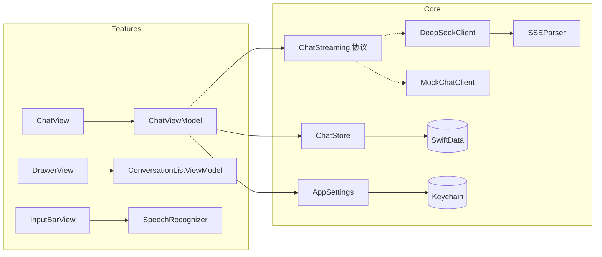

# WBChatApp

一个接入 DeepSeek 的 AI 聊天 iOS App，采用 SwiftUI + SwiftData + MVVM 构建。除 Markdown 渲染外全部使用系统框架实现，唯一的三方依赖是 [MarkdownUI](https://github.com/gonzalezreal/swift-markdown-ui)。

> 未配置 API Key 时自动进入**演示模式**（内置 Mock 流式数据源），无网络也能完整体验所有交互。

## 预览

| 流式输出 | 深度思考 | 会话抽屉 |
| :---: | :---: | :---: |
|  |  |  |

## 功能

| 功能 | 说明 |
| --- | --- |
| 流式输出 | 自研 SSE 客户端逐 token 接收，50ms 节流合批刷新 UI |
| Markdown 渲染 | 标题 / 列表 / 表格 / 引用，代码块带语言标签和复制按钮 |
| 深度思考 | 一键切换 `deepseek-reasoner`，推理过程实时流式展示、可折叠 |
| 重新生成 | 结果以多版本保存，`< i/n >` 左右切换任意版本 |
| 停止生成 | 流式过程中可随时停止，已生成内容保留落库 |
| 语音输入 | 按住说话，实时中文识别回填输入框，音量驱动波形动画 |
| 会话管理 | 抽屉手势容器，历史按「今天 / 昨天 / 年月」分组 |
| 长按操作 | 会话长按重命名、删除（二次确认，级联删除消息） |
| 搜索 | 同时匹配会话标题与消息内容 |
| 配置入口 | API Key（钥匙串）/ Base URL / 模型 / 温度 |

## 架构

MVVM + Apple Observation 框架（`@Observable`），单向依赖：**View → ViewModel → Core（Network / Storage）**。



### 关键设计

- **流式管道**：`URLSession.bytes(for:)` 逐行读取 SSE → 纯函数 `SSEParser` 解析 → `AsyncThrowingStream` 吐增量 → ViewModel 节流合批更新 `@Observable` 状态。消费方取消时通过 `onTermination` 自动断开请求。
- **协议抽象**：网络层只暴露 `ChatStreaming` 协议，真实客户端与 Mock 客户端可互换——既支撑演示模式，也让流式逻辑可测。
- **多版本消息**：`Message.contents` 存全部生成版本，`currentVersionIndex` 指向当前展示版本，重新生成即追加，天然支持版本回看。
- **性能**：流式期间按 50ms 节流刷新，避免每 token 触发 Markdown 重解析；消息列表 `LazyVStack` 懒加载；正在生成的内容与已落库消息分离渲染，不整表刷新。
- **安全**：API Key 存系统钥匙串，不落 UserDefaults、不进代码。

## 目录结构

```
WBChatApp/
├── App/                     # 入口、根容器、抽屉容器、全局路由
├── Features/                # 按业务特性分组，View 与 ViewModel 就近放置
│   ├── Chat/                # 聊天页：消息列表、气泡、输入栏、思考过程
│   ├── ConversationList/    # 抽屉：搜索、时间分组、长按操作
│   ├── VoiceInput/          # 语音识别、录音浮层、波形动画
│   └── Settings/            # DeepSeek 配置入口
└── Core/                    # 与 UI 无关的基础能力
    ├── Network/             # SSE 客户端、解析器、DTO、错误定义
    ├── Storage/             # SwiftData 模型、仓储层、钥匙串、设置
    └── Extensions/          # 时间分组、Markdown 主题、键盘工具
```

## 技术栈

| 关注点 | 选型 |
| --- | --- |
| UI | SwiftUI（iOS 17+） |
| 状态管理 | `@Observable`（Observation 框架） |
| 持久化 | SwiftData |
| 网络 | URLSession + 自研 SSE 解析 + Swift Concurrency |
| 语音 | Speech（SFSpeechRecognizer）+ AVAudioEngine |
| Markdown | MarkdownUI（唯一三方依赖，SPM 引入） |

## 测试

- **单元测试**（Swift Testing）：SSE 解析（正常增量 / 推理增量 / `[DONE]` / 非法 payload / 空白容错）、默认标题生成、时间分组
- **UI 测试**（XCUITest）：发送消息后流式回复完整渲染、设置页弹出（环境对象注入回归）

```bash
xcodebuild -project WBChatApp.xcodeproj -scheme WBChatApp \
  -destination 'platform=iOS Simulator,name=iPhone 17' test
```

## 运行

1. Xcode 16+ 打开 `WBChatApp.xcodeproj`，等待 SPM 解析完成后直接运行（默认演示模式）
2. 接入真实模型：抽屉底部 ⚙️ 进入设置，填入 [DeepSeek 平台](https://platform.deepseek.com) 申请的 API Key
3. 输入栏「深度思考」开关切换 `deepseek-chat` / `deepseek-reasoner`
